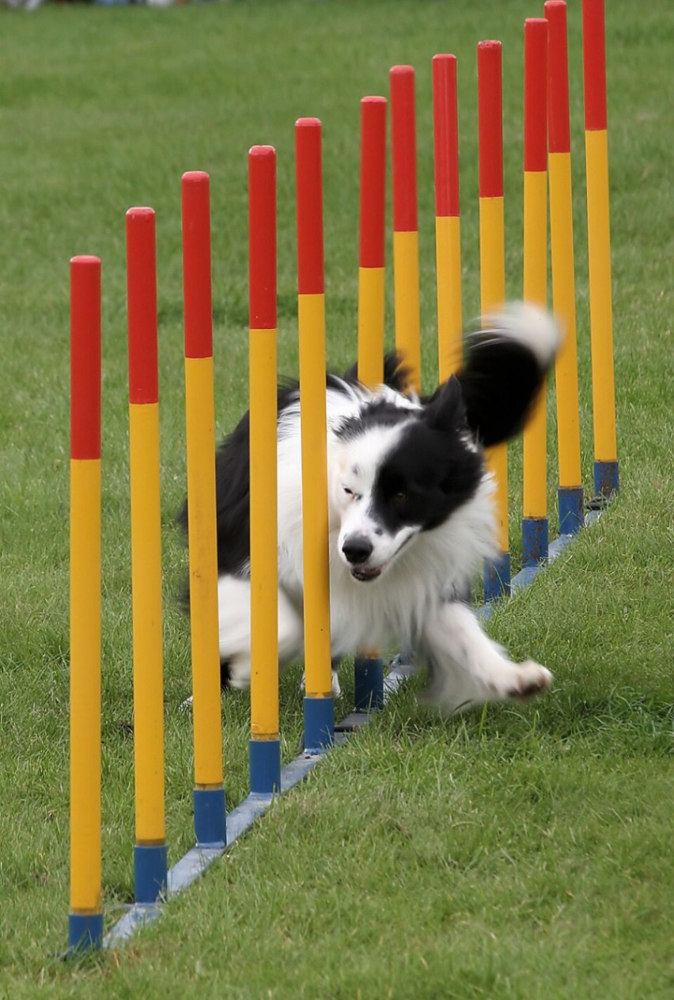

アジャイルは速いと勘違いされがちだ。アジャイルにしても、プロジェクトが早く終わるわけではない。

速さには向きがある。垂直方向の速さは物事を前へ進める速さで、リリースを早めるのがこれにあたる。水平方向の速さは、変化に合わせて向きを変える速さだ。アジャイルで上がるのは水平方向の速さ、つまり適応の速さの方だ。

| 向き | 何の速さか | 上げる手段の例 | アジャイルで上がるか |
| --- | --- | --- | --- |
| 垂直 | 物事を前へ進める速さ。リリースを早める | 人を増やす、範囲を削る | 上がらない |
| 水平 | 変化に合わせて向きを変える速さ | 短い反復、早いフィードバック | 上がる |

アジリティ競技でボーダーコリーが走る映像を見ると分かりやすい。縦に並んだ棒の間を、左右に向きを変えながらすり抜けていく。見ていて速いと感じるのは、この向きを変える速さだ。

「agile」という語は、アジャイルソフトウェア開発宣言のときに選ばれた。ほかの候補は「adaptive」と「flexible」だったらしい。LeSS の Craig Larman さんが研修で話した内容を、参加者が note に書いている。

https://note.com/tg_developer/n/n76fb8b03e66e

その記事では、agile に「迅速な」という和訳があることが誤解の一因になったのでは、と推測している。

速さをこう捉えると、「アジャイルにすれば早く終わる」「遅れているプロジェクトをアジャイルで取り戻す」といった判断は間違っていると分かる。こういう判断が出てきたら、速さの意味を取り違えている危険信号だ。そのまま進めてもうまくいかないので、まず認識を合わせるところから始めることになる。
