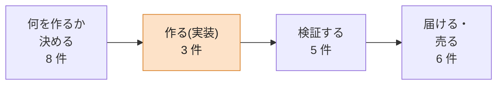
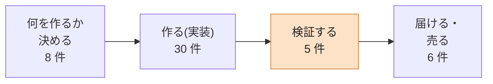
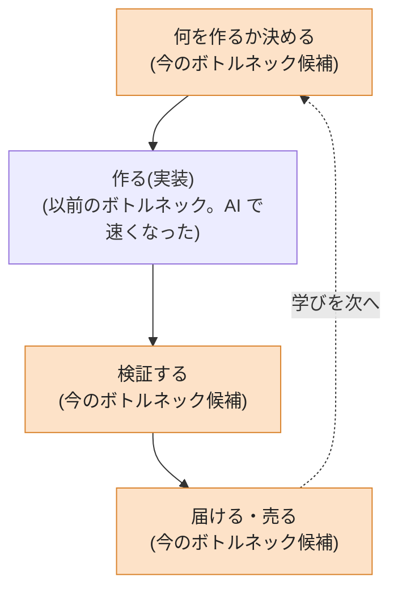
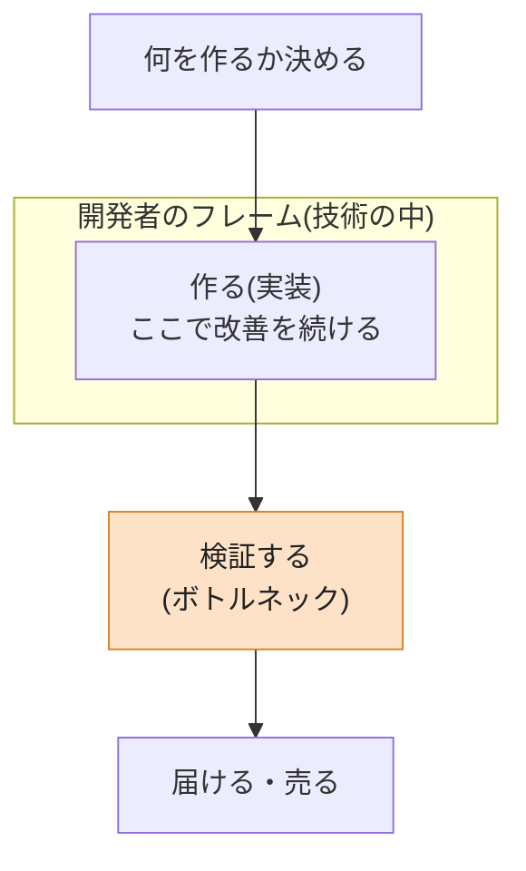

AI によって、プロダクトづくりのボトルネックが実装から別の工程に移った。この変化を『ザ・ゴール』の考え方に沿って考えてみる。

『ザ・ゴール』で扱われる制約理論では、工程がつながった仕組みの出来高は、いちばん処理の遅い工程(ボトルネック)で決まる。ボトルネック以外の工程を速くしても、ボトルネックの手前に仕掛かりが溜まるだけで、全体の出来高は増えない。そしてボトルネックを解消すると、次に遅い工程が新しいボトルネックになる。

数字の例で図にします。各工程が 1 週間に処理できる件数を、架空の数字で置いています。

AI 以前は実装が 3 件で一番小さいので、全体の出来高も 1 週間に 3 件になる。企画が 8 件の案を出しても、残りの 5 件は実装の手前に溜まっていく。

AI で実装が 30 件に増えると、次の図のようになる。

実装が 10 倍になっても、全体の出来高は 3 件から 5 件にしか増えない。今度は検証の 5 件が一番小さいからだ。実装をさらに 100 件に増やしても全体は 5 件のままで、増えた分は検証の手前に溜まる。

## 実装はボトルネックでなくなった

プロダクトをビジネスとして見ると、工程はおおよそ次のように並ぶ。以前のボトルネックと今のボトルネックの位置を図にします。

図が示しているのは、ボトルネックが実装から前後の工程に移ったことと、移った先が 1 か所に決まらないことだ。

以前は実装に人も時間もかかったので、実装がボトルネックだった。企画は実装を待ち、作りたいものの案が溜まっていた。AI がコードを書くようになって、実装にかかる時間は大きく減った。

すると制約は前後の工程に移る。何を作るか、作ったものをどう検証するか、どう届けて売るか。どこに移ったかはビジネスごとに違う。

## 開発の中だけで解こうとすると、生産性は上がらない

ところが、多くの開発者は開発の枠の中でしか物事を解決できない。だから、もうボトルネックではない実装に労力を割き続ける。

開発の中の改善は、開発の中では成果に見える。ただ、ボトルネックが検証にあるなら、速く作ったものは検証待ちの列に積み上がるだけだ。ビジネス全体の生産量は上がらない。

これは個人のフレーム問題だと思う。人は自分に見えている範囲(フレーム)の中で問題を立て、その中で解く。開発者のフレームが技術の中に収まっていると、問題を技術の問題として立て、技術で解こうとする。

ボトルネックが検証にある場合を図にします。

図が示しているのは、ボトルネックがフレームの外にあると、フレームの中でいくら問題を解いてもビジネスは前に進まない、ということだ。ボトルネックがそこにないからだ。

フレームを広げて、より全体を見ないといけない。今解いている問題がビジネス全体のどこにあるのか、ボトルネックが自分のフレームの中にあるのかを確かめてから解く。

## 移ったボトルネックを解消しにいく

だからエンジニアは、ビジネスをもっと俯瞰して、移ったボトルネックを解消しにいく必要がある。何を作るかが詰まっているなら PdM の役割を担う。検証が詰まっているなら自分で検証を回す。売る工程が詰まっているなら営業にも出る。

移った先のポジションを 1 つ選んでも、それで終わりにはならない。ボトルネックは解消すると次の工程に移る。1 つのポジションに留まる人は、そのポジションがボトルネックでなくなった時点で、今の開発者と同じ状況に戻る。残るのは、ビジネス全体のパイプラインを通して、その時々のボトルネックで活躍できる人材だと思う。

AI によって変化の激しい時代になり、次にどこへボトルネックが移るかは分からない。工程ごとに担当を固定する分業では、ボトルネックが移るたびに人の配置を組み替えないと、全体の出来高が上がらない。だから過度な分業のスタイルは、時代遅れなものになっていくだろう。

## コードが書けるだけでお金がもらえた構造は終わる

開発しかできない人は、これからどんどん淘汰されていくと思う。

今までは、コードが書けるだけでお金がもらえた。実装がボトルネックだったので、実装できる人に報酬が集まっていた。ただ、それはいびつな産業構造だった。ボトルネックが移れば、報酬が集まる場所も移る。いびつな構造は淘汰されていく。

だからこそ AI 時代のエンジニアは、ビジネスの最初から最後まで、全体を通してやれるようにならないといけない。
