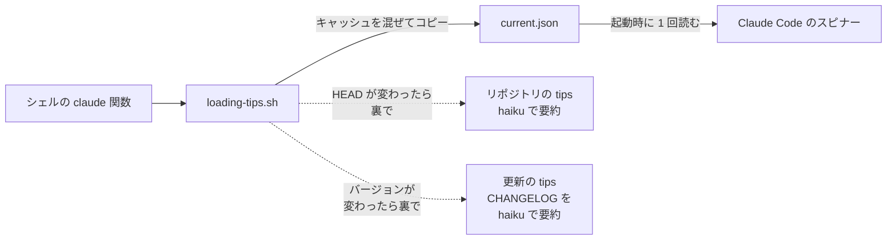

Claude Code は応答を待つ間、スピナーの下に 1 行の tips を出します。標準では Claude Code 自体の使い方の tips で、何度か使ううちに見たことのある文ばかりになります。

この tips は、`settings.json` の `spinnerTipsOverride` で自分で用意したファイルに差し替えられます。差し替えた後のファイルは、自分に役立つ情報を流す 1 行の表示欄として使えます。裏で情報を集め、短く要約して最新に保っておけば、待ち時間に目に入るのは毎回少しずつ違う、自分に関係のある情報になります。自分から探しに行かなかった更新や約束事を、待ち時間にたまたま知る機会もできます。

この記事では、作り方を 2 つの例で説明し、最後に流せそうな情報の案を並べます。私が今流しているのは次の 2 種類です。

- 起動したリポジトリの約束事や最近の作業(CLAUDE.md・README・直近のコミットから作る)
- Claude Code の直近の更新内容(公式の CHANGELOG から作る)

どちらも `claude -p --model haiku` に裏で要約させています。起動を待たせないように、起動時にはキャッシュをコピーするだけにしました。

## 全体像

起動のたびに走るのはコピーだけで、作り直しは材料が変わったときだけ裏で走ります。



図の点線は、次回の起動から使うキャッシュを作る処理です。今回の起動は待ちません。

## 1. 設定

`~/.claude/settings.json` に次を書きます。

```json
"spinnerTipsOverride": {
  "excludeDefault": true,
  "tipsFile": "~/.claude/loading-tips/current.json"
}
```

- `excludeDefault: true` で標準の tips を出さなくなります
- `tipsFile` は文字列の JSON 配列のファイルです。パスは絶対パスか `~/` 始まりにします。それ以外のパスは警告を出して無視されます(手元の 2.1.306 の本体に含まれるエラーメッセージで確認しました)
- ファイルを使わずに、設定の中へ tips を直接並べることもできます

Claude Code がこのファイルを読むのは起動時の 1 回だけです。そのため、起動の直前にファイルを書き換えれば、起動したディレクトリごとに中身を変えられます。

## 2. 起動を待たせない作り

シェルの `claude` を関数で包み、起動の直前にスクリプトを呼びます。

```bash
function claude() {
  ~/.claude/bin/loading-tips.sh "$PWD" >/dev/null 2>&1
  command claude "$@"
}
```

スクリプトが同期的に行う処理は、キャッシュを `current.json` に書き出すことだけです。手元では 0.1 秒で終わります。

キャッシュの作り直しは裏で行い、作り直すきっかけを材料ごとに分けています。

| tips | キャッシュの鍵 | 作り直すきっかけ |
| --- | --- | --- |
| リポジトリ | リポジトリのパス | `git rev-parse HEAD` が前回と違う |
| Claude Code の更新 | 1 つだけ | `claude --version` が前回と違う |

作り直しの中身は次のとおりです。

```bash
# 別の起動が生成中なら任せる(10 分以上前のロックは残骸とみなす)
locked() {
  [ -e "$1" ] && [ -z "$(find "$1" -mmin +10 2>/dev/null)" ]
}

# 生成用の呼び出しで hooks やセッション記録を残さないよう、ユーザー設定を読まずに一時ディレクトリで動かす
ask_haiku() {
  cd "$OUT_DIR" && command claude -p --model haiku --no-session-persistence --setting-sources project 2>/dev/null
}

if [ -n "$CC_VERSION" ] && ! { [ -s "$CC_CACHE" ] && [ "$(cat "$CC_STAMP" 2>/dev/null)" = "$CC_VERSION" ]; } && ! locked "$CC_LOCK"; then
  touch "$CC_LOCK"
  generate_cc >/dev/null 2>&1 </dev/null &
  disown
fi
```

`--setting-sources project` を付けているのは、生成のための `claude -p` で自分の hooks が動いたり、セッションの記録が残ったりしないようにするためです。

リポジトリのキャッシュがまだない初回は、直近 8 件のコミット件名をそのまま tips にして出します。

## 3. リポジトリの tips

材料は、リポジトリ名・ブランチ・直近 20 件のコミット件名・未コミットの変更ファイル・CLAUDE.md と README.md の先頭 6000 文字です。haiku への指示は次のとおりです。

```text
以下のリポジトリ情報から、AI の応答を待つ間に開発者の画面に 1 つずつ表示する tips を 15 個作ってください。
- 対象: このリポジトリの設計判断・使い方・約束事・最近進めている作業。一般論は書かない
- 1 個 60 文字以内の日本語。比喩・誇張・決め台詞を使わず、事実を平叙文で書く
- 出力は JSON の文字列配列だけ。コードブロックや説明文を付けない
```

CLAUDE.md に書いた約束事が待ち時間に何度か目に入るので、自分で決めた規則を忘れにくくなります。

## 4. Claude Code の更新の tips

公式の CHANGELOG(`https://raw.githubusercontent.com/anthropics/claude-code/main/CHANGELOG.md`)を取り、今入っているバージョンから下の 5 バージョン分を切り出します。CHANGELOG は `## 2.1.306` のようにバージョンごとの見出しで区切られているので、見出しで分割するだけで済みます。

```python
parts = re.split(r"^## ", changelog, flags=re.M)[1:]
idx = next((i for i, p in enumerate(parts) if p.split("\n", 1)[0].strip() == ver), 0)
notes = "".join("## " + p for p in parts[idx:idx + 5])[:12000]
```

haiku への指示では、対象をターミナルで使う人に関係する追加と変更に絞りました。バグ修正だけの項目と、VSCode・クラウド環境向けの項目は外します。

```text
- 対象: ターミナルの CLI を日常的に使う人に関係する追加・変更。VSCode・Cloud sessions・Self-hosted runner・バグ修正だけの項目は選ばない
- 形式: 「Claude Code <バージョン>: <何ができるようになったか>」。1 個 70 文字以内の日本語。設定名・コマンド名は原文のまま書く
```

2.1.306 の時点では、次のような tips が出ました。

- Claude Code 2.1.304: /auto-mode-setup で auto mode の環境設定を案内付きで行える
- Claude Code 2.1.304: Ctrl+O 表示の compaction 要約に、呼ばれたツール名が含まれる
- Claude Code 2.1.305: /usage の各警告に修正案が1行で表示され、f キーで修正を適用できる

Claude Code は更新が頻繁で、CHANGELOG を自分から読みに行くことはあまりありません。待ち時間に出しておけば、新しいコマンドや設定に気づけます。

`current.json` を書くときは、リポジトリの tips 15 個と更新の tips 5 個を交互に並べています。どちらかだけが続けて出ないようにするためです。

## 5. 他に流せそうな情報

ここからは実装していない案です。材料の取り方と haiku への指示を変えるだけで、同じ作り(起動時はコピー、材料が変わったら裏で作り直す)のまま流せます。

リポジトリの中にあるもの:

- ADR の決定: `docs/adr/` の各ファイルから「何を決めたか」を 1 行ずつ。新しく入ったリポジトリで、過去の判断を知る機会になる
- ドメイン用語: 用語集から「用語: 定義」を 1 行ずつ。業務の言葉に慣れるまでの間に向いている
- やってはいけないこと: CLAUDE.md の禁止事項だけを抜き出す

外から集めるもの:

- 主要なライブラリの更新: `package.json` などの依存から主要なものを選び、GitHub の Releases から直近の変更を要約する
- クラウドの更新情報: AWS の What's New のように、提供元が出している更新の一覧から、自分が使っているサービスの分だけを拾う
- チームに流れている告知: チャンネルに流れる更新情報の投稿を、自分に関係のあるものだけ要約する

外から集める情報は、Claude Code の CHANGELOG と同じく、自分から読みに行く回数が少ないものです。待ち時間の 1 行に出しておけば、読みに行かなくても目に入ります。
