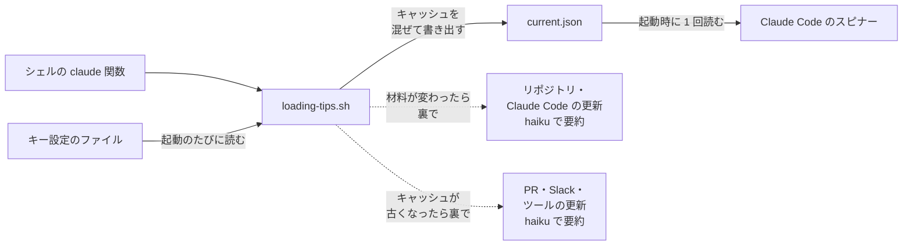

Claude Code は応答を待つ間、スピナーの下に 1 行の tips を出します。標準では Claude Code 自体の使い方の tips で、何度か使ううちに見たことのある文ばかりになります。


この tips は、`settings.json` の `spinnerTipsOverride` で自分で用意したファイルに差し替えられます。上の画像は、差し替えた後のスピナーです。ターミナルアプリのショートカットキーを出しています。

差し替えた後のファイルは、自分に役立つ情報を流す 1 行の表示欄として使えます。裏で情報を集め、要約して最新に保っておけば、待ち時間に目に入るのは毎回少しずつ違う、自分に関係のある情報になります。自分から探しに行かなかった更新や約束事を、待ち時間にたまたま知る機会もできます。

私が今流しているのは次の 6 種類です。

| tips | 材料 |
| --- | --- |
| 起動したリポジトリの約束事や最近の作業 | CLAUDE.md・README・直近のコミット。材料にするファイルを自分で指定することもできる |
| Claude Code の直近の更新内容 | 公式の CHANGELOG |
| 自分が関わっている Slack チャンネルの最近の動き | チャンネルの直近 72 時間のメッセージ |
| 自分が出している open な PR の概要と状態 | `gh` で取った PR の本文・レビュー・CI |
| 使っているツールの更新内容 | pnpm・GitHub・ターミナルアプリのリリースノート |
| ターミナルアプリのショートカットキー | アプリのキー設定のファイル |

上の 5 種類は `claude -p --model haiku` に裏で要約させています。ショートカットキーだけは、設定ファイルからスクリプトで作ります。起動を待たせないように、起動時にはキャッシュを混ぜて書き出すだけにしました。

この記事では、共通の作りを先に説明し、その後に 6 種類を順に説明します。

## 全体像

起動のたびに走るのは、キャッシュを混ぜて書き出す処理と、ショートカットキーの tips を作る処理だけです。要約の作り直しは、材料が変わったときか、キャッシュが古くなったときだけ裏で走ります。



図の点線は、次回の起動から使うキャッシュを作る処理です。今回の起動は待ちません。

## 1. 設定

`~/.claude/settings.json` に次を書きます。

```json
"spinnerTipsOverride": {
  "excludeDefault": true,
  "tipsFile": "~/.claude/loading-tips/current.json"
}
```

- `excludeDefault: true` で標準の tips を出さなくなります
- `tipsFile` は文字列の JSON 配列のファイルです。パスは絶対パスか `~/` 始まりにします。それ以外のパスは警告を出して無視されます(手元の 2.1.325 の本体に含まれるエラーメッセージで確認しました)
- ファイルを使わずに、設定の中へ tips を直接並べることもできます

Claude Code がこのファイルを読むのは起動時の 1 回だけです。そのため、起動の直前にファイルを書き換えれば、起動したディレクトリごとに中身を変えられます。

## 2. 起動を待たせない作り

シェルの `claude` を関数で包み、起動の直前にスクリプトを呼びます。

```bash
function claude() {
  ~/.claude/bin/loading-tips.sh "$PWD" >/dev/null 2>&1
  command claude "$@"
}
```

スクリプトが同期的に行う処理は、キャッシュとショートカットキーの tips を混ぜて `current.json` に書き出すことだけです。手元では 0.1 秒で終わります。

キャッシュの作り直しは裏で行い、作り直すきっかけを材料ごとに分けています。

| tips | 作り方 | 作り直すきっかけ |
| --- | --- | --- |
| リポジトリ | haiku で要約 | `git rev-parse HEAD` が前回と違う |
| 指定した材料ファイル | haiku で要約 | ファイルの一覧か、各ファイルの更新時刻が前回と違う |
| Claude Code の更新 | haiku で要約 | `claude --version` が前回と違う |
| 自分の open な PR | haiku で要約 | キャッシュが 1 時間より古い |
| Slack | haiku で要約 | キャッシュが 1 日より古い |
| ツールの更新 | haiku で要約 | キャッシュが 1 日より古い |
| ショートカットキー | スクリプトだけ | 起動のたびに作る |

リポジトリのキャッシュはリポジトリごとに、材料ファイルのキャッシュはファイルの一覧を置いたディレクトリごとに 1 つずつ持ちます。他の 4 つのキャッシュは、どこで起動しても同じものを使います。

`current.json` を書くときは、各種類の tips を均等に混ぜて並べています。どれか 1 種類だけが続けて出ないようにするためです。

裏で作り直す部分は次のとおりです(Claude Code の更新の tips の場合)。

```bash
# 別の起動が生成中なら任せる(10 分以上前のロックは残骸とみなす)
locked() {
  [ -e "$1" ] && [ -z "$(find "$1" -mmin +10 2>/dev/null)" ]
}

# 生成用の呼び出しで hooks やセッション記録を残さないよう、ユーザー設定を読まずに一時ディレクトリで動かす
ask_haiku() {
  cd "$OUT_DIR" && command claude -p --model haiku --no-session-persistence --setting-sources project 2>/dev/null
}

if [ -n "$CC_VERSION" ] && ! { [ -s "$CC_CACHE" ] && [ "$(cat "$CC_STAMP" 2>/dev/null)" = "$CC_VERSION s$SCHEMA" ]; } && ! locked "$CC_LOCK"; then
  touch "$CC_LOCK"
  generate_cc >/dev/null 2>&1 </dev/null &
  disown
fi
```

`--setting-sources project` を付けているのは、生成のための `claude -p` で自分の hooks が動いたり、セッションの記録が残ったりしないようにするためです。

`$SCHEMA` は、haiku への指示の版を表す番号です。指示や件数を変えたときにこの番号を上げると、前回の印と一致しなくなるので、次の起動でキャッシュが作り直されます。

haiku の出力は、JSON の配列として読めた部分だけを使います。150 文字を超えた tips は捨てます。途中で切ると文として読めなくなるためです。1 個も残らなかったときは、前のキャッシュをそのまま使います。

## 3. リポジトリの tips

材料は、リポジトリ名・ブランチ・直近 40 件のコミット件名・未コミットの変更ファイル・CLAUDE.md と README.md の先頭 15000 バイトです。haiku への指示は次のとおりです。

```text
以下のリポジトリ情報から、AI の応答を待つ間に開発者の画面に 1 つずつ表示する tips を 50 個作ってください。
- 対象: このリポジトリの設計判断・使い方・約束事・最近進めている作業。一般論は書かない
- 1 個 120 文字以内の日本語。理由や背景があれば添える。比喩・誇張・決め台詞を使わず、事実を平叙文で書く
- 同じ内容を言い換えて数を埋めない。材料に書いていないことは書かない
- 出力は JSON の文字列配列だけ。コードブロックや説明文を付けない
```

CLAUDE.md に書いた約束事が待ち時間に何度か目に入るので、自分で決めた規則を忘れにくくなります。

リポジトリのキャッシュがまだない初回は、直近 8 件のコミット件名をそのまま tips にして出します。

### 材料にするファイルを指定する

起動するディレクトリに `.claude/loading-tips-sources` を置くと、git の情報の代わりに、そこに並べたファイルを材料にします。1 行に 1 つ、そのディレクトリからの相対パスを書きます。

```text
# 用語
docs/glossary.md
# 設計判断(ADR)
docs/adr/README.md
docs/adr/0003-example.md
# 作業の約束事
CLAUDE.md
```

(このパスは例です)

私は、複数のリポジトリを並べて置いた親ディレクトリにこのファイルを置いています。親ディレクトリは git リポジトリではありませんが、ファイルを指定すれば tips を作れます。材料には、用語集・ADR・各リポジトリの CLAUDE.md を選びました。ADR の tips は、新しく入ったリポジトリで過去の判断を知る機会になります。用語の tips は、業務の言葉に慣れるまでの間に向いています。

haiku への指示は、対象と形式をこの用途に合わせています。

```text
- 対象: 資料に書かれた設計判断(ADR の決定と理由)・ドメイン用語の定義・プロダクトの約束事。一般論は書かない
- ADR の決定を書くときは「ADR-番号: 決定内容」の形にする。用語は「用語名: 定義」の形にする
```

大きいファイルは、ランダムな位置から 12000 文字を切り出して渡します。先頭から切り出すと、作り直すたびに同じ部分の tips になるためです。

## 4. Claude Code の更新の tips

公式の CHANGELOG(`https://raw.githubusercontent.com/anthropics/claude-code/main/CHANGELOG.md`)を取り、今入っているバージョンから下の 15 バージョン分を切り出します。CHANGELOG は `## 2.1.325` のようにバージョンごとの見出しで区切られているので、見出しで分割するだけで済みます。

```python
parts = re.split(r"^## ", changelog, flags=re.M)[1:]
idx = next((i for i, p in enumerate(parts) if p.split("\n", 1)[0].strip() == ver), 0)
notes = "".join("## " + p for p in parts[idx:idx + 15])[:40000]
```

haiku への指示では、対象をターミナルで使う人に関係する追加と変更に絞りました。バグ修正だけの項目と、VSCode・クラウド環境向けの項目は外します。

```text
- 対象: ターミナルの CLI を日常的に使う人に関係する追加・変更。VSCode・Cloud sessions・Self-hosted runner・バグ修正だけの項目は選ばない
- 形式: 「Claude Code <バージョン>: <何ができるようになったか>」。1 個 120 文字以内の日本語。設定名・コマンド名は原文のまま書く
```

2.1.325 の時点では、次のような tips が出ました。

- Claude Code 2.1.325: ポリシーでリクエストがブロックされたとき、エラーの下に `/rewind` で発言を変更する方法と `/clear` の実行を案内する行が表示される。
- Claude Code 2.1.323: `claude plugin validate` が plugin の TypeScript hooks モジュールを型チェックする。検出は警告で、`--strict` 指定時は失敗する。
- Claude Code 2.1.323: 環境変数 `CLAUDE_CODE_DISABLE_AGENT_PROGRESS_SUMMARIES=1` で subagent の進捗要約と、その要約を書くリクエストを無効にできる。

Claude Code は更新が頻繁で、CHANGELOG を自分から読みに行くことはあまりありません。待ち時間に出しておけば、新しいコマンドや設定に気づけます。

## 5. Slack の最近の動き

自分が関わっているチャンネルを決めておき、直近 72 時間のメッセージから「今チームで何が進んでいるか」を tips にします。待ち時間に目に入るので、Slack を開く前に、チームの今の状況を知ることができます。

ただし、自分宛ての依頼やメンションを拾う用途には向きません。tips は待ち時間に 1 行ずつ、順番を決めずに出るだけだからです。拾えるのは、知っておくと話についていきやすくなる程度の情報です。

Slack には HEAD やバージョンのような変化の印がないので、キャッシュが 1 日より古くなったら作り直します。

```bash
if [ ! -s "$SLACK_CACHE" ] || [ -n "$(find "$SLACK_CACHE" -mmin +1440 2>/dev/null)" ]; then
  ...
fi
```

Slack は claude.ai の Slack コネクタ経由で読みます。他の tips では `--setting-sources project` でユーザー設定を読まずに動かしていますが、その状態ではコネクタが使えませんでした。そこで Slack だけはユーザー設定を読む形で動かし、代わりに次の 2 つで生成の呼び出しを絞っています。

- `--settings '{"disableAllHooks": true}'` で、自分の hooks を止める
- `--allowedTools` に読み取りのツール(`slack_read_channel` と `slack_read_thread`)を並べて、確認なしで実行できるようにする。送信やリアクションなど書き込みのツールは `--disallowedTools` に並べて禁止する

```bash
printf '%s\n' "$prompt" |
  (cd "$OUT_DIR" && command claude -p --model haiku --no-session-persistence \
    --settings '{"disableAllHooks": true}' \
    --allowedTools "mcp__claude_ai_Slack__slack_read_channel,mcp__claude_ai_Slack__slack_read_thread" \
    --disallowedTools "mcp__claude_ai_Slack__slack_send_message,mcp__claude_ai_Slack__slack_add_reaction,...")
```

haiku への指示では、チャンネルの ID と表示名を並べて渡し、選ぶ対象と書き方を決めています。

```text
読んだメッセージから、AI の応答を待つ間に開発者の画面に 1 つずつ表示する tips を、チャンネルごとに最大 8 個作ってください。
- 対象: チームで今進んでいること、最近決まったこと、レビューや確認を待っているもの。雑談・挨拶・bot の定型通知は選ばない
- 形式: 「<表示名>: <何が起きているか>」。1 個 120 文字以内の日本語。人の名前は書かない
```

出力は「frontend: 一覧画面の改修方針が決まり、PR がレビュー待ち」のような形になります(この例は架空です)。チャンネルを読んで要約するのには数十秒かかります。すべて裏で走るので、起動は待たせません。

## 6. 自分が出している PR

自分が出している open な PR を、1 件につき 1 個の tips にします。待ち時間に 1 件ずつ出しておけば、変更要求が付いた PR や CI が失敗した PR を、一覧を開く前に知ることができます。

材料は `gh` で取ります。一覧は全リポジトリを対象に検索し、レビューと CI の状態は 1 件ずつ取ります。検索の結果には、この 2 つが含まれないためです。

```python
prs = gh("search", "prs", "--author", "@me", "--state", "open", "--sort", "updated",
         "--limit", limit, "--json", "repository,number,title,body,isDraft,updatedAt")
for p in prs or []:
    repo = p["repository"]["nameWithOwner"]
    v = gh("pr", "view", str(p["number"]), "-R", repo, "--json", "reviewDecision,statusCheckRollup") or {}
```

haiku には、PR ごとに draft かどうか・レビューの結果・CI の結果と、本文の先頭 1500 文字を渡します。指示は次のとおりです。

```text
- 形式: 「自分の PR <リポジトリ名>#<番号>: <何をする PR か>(<状態>)」。状態は draft・レビュー・CI のうち、次に手を動かす理由になるもの(draft、変更要求あり、CI 失敗、承認済みでマージ待ち など)を短く書く
- 「何をする PR か」は本文から目的と変更内容を 1 文で書く。タイトルの言い換えで済ませない
- 1 個 140 文字以内の日本語。比喩・誇張を使わず、材料に書いてある事実だけを平叙文で書く
```

出力は「自分の PR api-server#123: 一覧 API の絞り込み条件に作成日を足す(CI 失敗)」のような形になります(この例は架空です)。

PR の状態は 1 日の中でも変わるので、キャッシュが 1 時間より古くなったら作り直します。open な PR が 0 件のときは、キャッシュを空の配列にします。マージ済みの PR が tips に残らないようにするためです。

## 7. 使っているツールの更新

Claude Code の CHANGELOG と同じ作りを、毎日使っている他のツールにも使っています。対象は pnpm、GitHub、Herdr(ターミナルとコーディングエージェントを並べて使うデスクトップアプリ)の 3 つです。

| ツール | 取得元 | 絞り方 |
| --- | --- | --- |
| pnpm | GitHub Releases の Atom フィード | 安定版だけ、5 件まで |
| GitHub | GitHub Changelog の RSS フィード | 30 件まで、1 件 800 文字まで |
| Herdr | リポジトリの CHANGELOG.md | 5 バージョンまで |

どれも直近 21 日分を取り、3 つをまとめて haiku に渡して、合わせて最大 25 個の tips にします。指示では、ツールごとに選ぶ対象と形式を決めています。

```text
- pnpm: 使い方や挙動が変わる追加・変更を選ぶ。形式は「pnpm <バージョン>: <何が変わったか>」
- GitHub: git・PR・Issues・Actions・gh CLI・Copilot のコーディング機能など、開発者が日常で使うものを選ぶ。Enterprise の管理・課金・データ所在地・Visual Studio 向けの項目は選ばない。形式は「GitHub: <何ができるようになったか>」
- Herdr: デスクトップ版の日常的な使い方や挙動が変わる追加・変更を選ぶ。形式は「Herdr <バージョン>: <何が変わったか>」
```

次のような tips が出ました。

- pnpm 12.19: pnpm store add にディレクトリを渡すと、配下の .tgz、.tar.gz、.tar を再帰的に追加する。例: pnpm store add ./tarballs
- GitHub: 個人アカウントのリポジトリで issue types と issue fields が使えるようになった。既定の issue types は Bug、Task、Feature で、最大 25 個まで作成できる
- Herdr 0.1.16: settings.json で copy_on_select を false にすると、テキスト選択時の自動コピーを無効にできる

GitHub Changelog には Enterprise の管理や課金の項目も並ぶので、指示で対象を開発者が日常で使うものに絞っています。

## 8. ショートカットキー(LLM を使わない tips)

tips は LLM に作らせなくても用意できます。私は Herdr のキー設定のファイル(`keys.json`)を読み、主要な操作のショートカットを tips にしています。

スクリプトには、tips にする操作と説明文の対応を書いておきます。キーの表記は、設定ファイルに書かれた割り当てから作ります。

```python
ACTIONS = {
    "app.palette": "コマンドパレットを開く。全コマンドを名前で探せて、割り当てたキーも表示される",
    "tab.new": "タブを新しく作る",
    "tab.rename": "タブの名前を変える",
    ...
}

for action, desc in ACTIONS.items():
    if action in bindings:
        shown = " または ".join(fmt(k) for k in bindings[action])
        tips.append(f"herdr: {shown} で{desc}")
```

出力は次のようになります。

- herdr: ⇧⌘P でコマンドパレットを開く。全コマンドを名前で探せて、割り当てたキーも表示される
- herdr: ⌘T でタブを新しく作る
- herdr: F2 でタブの名前を変える

設定ファイルを直接読むので、キーの割り当てを変えると、次の起動から tips の表記も変わります。LLM を呼ばないので、キャッシュを持たずに起動のたびに作っています。

## 9. 他に流せそうな情報

ここからは実装していない案です。

- クラウドの更新情報: AWS の What's New のように、提供元が出している更新の一覧から、自分が使っているサービスの分だけを拾う
- 依存しているライブラリの更新: `package.json` に書かれた主要なライブラリの、直近のリリースでの変更を要約する

どちらも「7. 使っているツールの更新」と同じ作りで、取得元と haiku への指示を足すだけで流せます。
