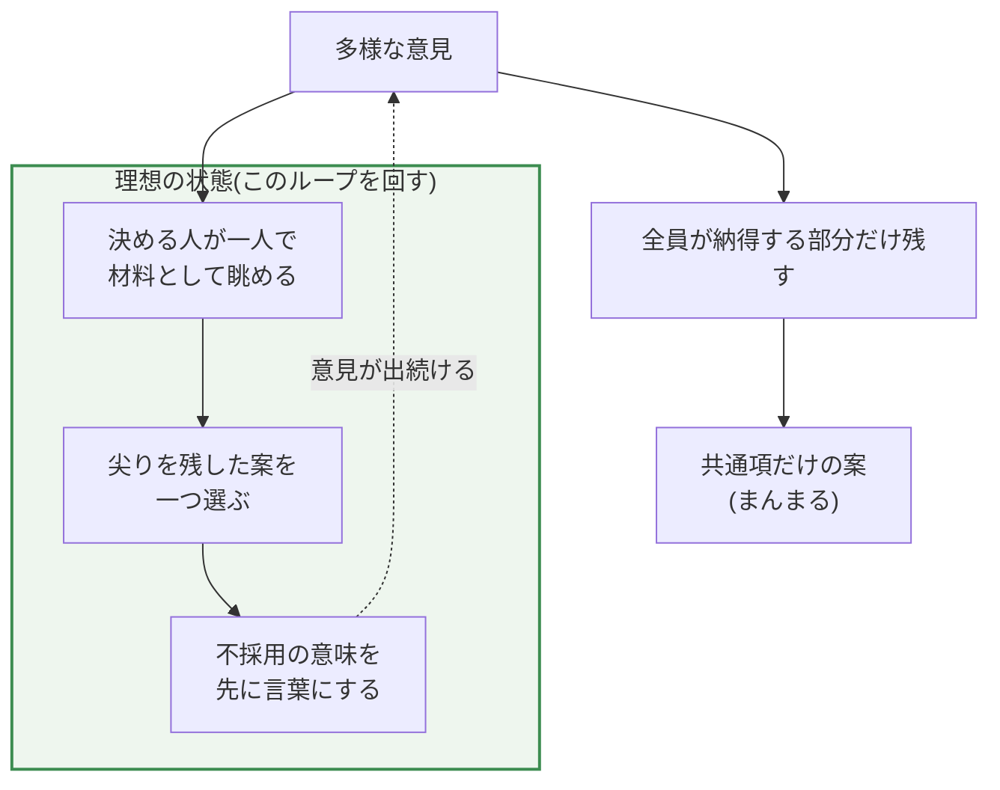

多様性は重要だけれど、メリットを享受し続けるのはケアが必要なタフな仕事になる。

- 全員が納得できる形を目指すと、エッジが消えて、誰にでも思いつく陳腐なものになる
- 多様な意見は票ではなく、決める人の盲点を埋める材料として使う。決めるのは一人
- バッサリ不採用が続くと人は意見を出さなくなり、多様性が持続しない。だから不採用が何を意味するのかを先に言葉にしておく（学習性無力感の状態にさせない）

全体の流れを先に図にします。意見を「票」として足すか、「材料」として一人が選ぶかで、残る形が変わります。

## 全員の意見を取り込んだら、エッジが消える

全員が賛成した意見は、賛成ではなく「反対ではない」であることが多いです。

そして、反対者のいない意見は、ありきたりで教科書どおりの、価値の薄いものになりやすいです。

なぜそうなるのか。複数の案から全員が納得できる部分だけを残すと、残るのは案同士の共通項です。各案の尖った部分は、誰かにとっては納得できない部分でもあるので、真っ先に削られます。

尖りをすべて削った形は「まんまる」で、まんまるは誰にでも描けます。

折衷でも全会一致でも、全員が賛成できる形を目指した時点で同じことが起きます。反対が一人でも出た部分から順に消えていくからです。民主的に決めたつもりでも、実際には角を落とす作業をしていることになります。

## 多様な意見は決める人の材料

では意見はいらないのかというと、逆です。意見を出す意味は、決める人の視野を広げることにあります。票を投じるためではありません。

『多様性の科学』（マシュー・サイド著）には、一人の人間が見られる範囲は狭く、違う背景の人が見ている範囲を重ねると盲点が減る、と書かれています。多様な意見は、決める人が「その角度は考えていなかった」と気づく材料になります。

材料は多いほどいいのですが、全部入れようとすると互いの尖りを打ち消し合います。

## 決めるのは一人

ここから先は本ではなく私の考えです。決めるのは一人がいいです。チームの中で、この機能がどうあるべきかを一番はっきりイメージできている人で、多くの場合それは PO（プロダクトオーナー）だと思います。

決める人が二人いると、二人の間でまた折衷が起きます。一貫したイメージは一人の頭の中にしかありません。

その人が全員の意見を材料として眺めて、「その角度は考えていなかった」を拾い、自分のイメージを直すのはいいです。ただし、案と案を足して二で割ることはしません。一つを選び、残りはバッサリ不採用にします。

反対が出ないように角を落とした時点で、最初のまんまるに戻ってしまうからです。

## バッサリが続くと、意見が出なくなる

ただ、出した意見が毎回バッサリ落ちると、そのうち出さなくなります。何をしても結果が変わらないと学ぶと、行動そのものが止まるためです。この状態は学習性無力感と呼ばれています。

自分だってそうなります。チームがそうなると多様な意見が集まらなくなって、決める人の盲点も戻ってきます。

意見を出しやすくすることと、バッサリ切ることは、放っておくと両立しません。両立させるには、不採用が何を意味するのかを、先に言葉にしておく必要があります。

## 浸透すべき 2 つの考え

次の 2 つの考えがチームに浸透しているとよいと思います。

- 不採用は、今回のイメージに合わなかったという意味で、案の出来に点数をつけたわけではない
- 出された案と比べたから、採用案の輪郭がはっきりした。出したこと自体が貢献

決める人が何も言わないと、「不採用だったから、自分の意見はダメだった」という読み方が本人の中で勝手に固まります。だから先に言っておきます。

## まとめ

- 全員が納得できる形を目指すと、尖りが削られて誰にでも思いつく仕様になる
- 多様な意見は決める人の盲点を埋める材料として使い、決めるのは一人
- バッサリ不採用が続くと意見が出なくなり、多様性が持続しない。だから不採用の意味を先に言葉にしておく

意見はどんどん出してほしいですし、多様性は大事です。採用されなくても落ち込む必要はありません。それは仕様です。そして決める人は、臆せず一人で決めるのがよいと思います。エッジを活かすために、そして意見が出続けるために。
