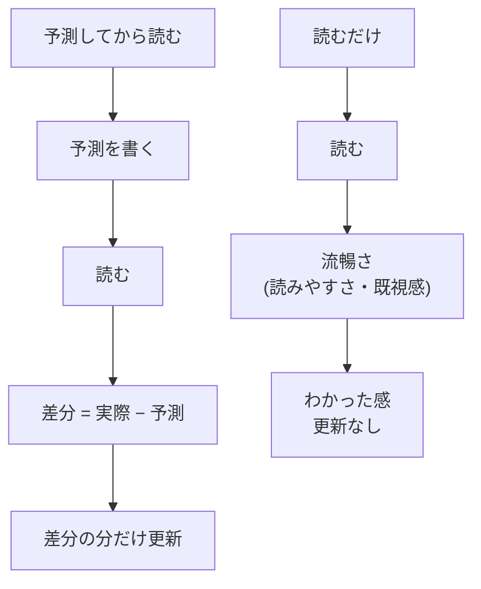

記事を読んでいる間は完全にわかった気がした。翌日、何も見ずに説明しようとしたら出てこない。この経験を何度もしているうちに、読んでいる間の「わかった」は理解とは別のものを測っているのではないかと思うようになりました。調べてみると、別のものでした。

同じ内容を解説動画(5 分)にもしています。文章より先に見ても、あとで見ても構いません。

<figure class="video-embed">
<iframe src="/videos/fluency-vs-diff.html" title="流暢性バイアスに囚われない、予測差分から導く真の理解(解説動画 5:30)" scrolling="no" loading="lazy"></iframe>
<figcaption><a href="/videos/fluency-vs-diff.html" target="_blank" rel="noopener">動画だけを別タブで開く</a>(台本と出典つき)</figcaption>
</figure>

## 読むだけの「わかった」は流暢さ

読んでいるときの「わかった」という感覚は、処理が軽かったという信号です。理解の信号ではありません。

Rhodes と Castel は 2008 年に、同じ単語を大きい文字と小さい文字で見せて「覚えられそうか」を予想させました。大きい文字の方が「覚えられそう」は高く出ました。実際に思い出せたかには差がありませんでした。読みやすさが、覚えた感に変わっています。

もっと困る結果もあります。Roediger と Karpicke は 2006 年に、文章を繰り返し読む群と、1 回読んだあとに思い出すテストを受ける群を比べました。1 週間後に思い出せたのはテスト群の方でした。ところが本人の確信は逆で、繰り返し読んだ群の方が「覚えられる」と答えています。読むたびに流暢になるので、確信だけが上がります。

| | 本人の確信 | 1 週間後の想起 |
| --- | --- | --- |
| 繰り返し読む | 高い | 低い |
| 読んでから想起テスト | 低い | 高い |

つまり、すらすら読めた記事ほど「わかった」と感じ、その感覚は当てになりません。これを流暢性バイアスと呼びます。整った文章や 2 回目の読書、見覚えのある話で、この感覚は強く出ます。

## 差分が出て初めて更新される

では何が理解の信号になるのか。予測と実際の差分です。

予測を置いて読む人と、読むだけの人で、頭に入る信号が違います。



Rescorla と Wagner が 1972 年に出した学習の式があります。

```
ΔV = αβ(λ − V)
```

ΔV が 1 回の経験でどれだけ学習が進むか、λ − V が「実際 − 予測」です。差分が 0 なら学習も 0 です。予測を立てていなければ V がないので、引き算が起きません。読んだ内容がそのまま置かれるだけです。読むだけの「わかった」が翌日に消えているのは、この式で言えば ΔV が出ていなかったからです。

外れた予測でも差分は出ます。Kornell たちは 2009 年に、単語の対を覚える課題で 2 つの群を比べました。予測群は最初の単語だけを 8 秒見て相手を当てずっぽうで答え、そのあと対を 5 秒見ます。読むだけの群は対を 13 秒見ます。1 回あたりの時間は同じで、答えを見ている時間は読むだけの群の方が長い。予測は 8〜9 割が外れていました。それでも最終テストの正答率は予測群が 67%、読むだけの群が 55% でした。38 時間後でも 47% と 35% で、差は残っています。

| 群 | 1 回の使い方 | 答えを見る時間 | 5 分後 | 38 時間後 |
| --- | --- | --- | --- | --- |
| 予測してから読む | 8 秒予測 + 5 秒読む | 5 秒 | 67% | 47% |
| 読むだけ | 13 秒読む | 13 秒 | 55% | 35% |

時間をかけて読んでも差分は出ません。外れた予測を置いた方が残ります。

## 流暢さを差分に変える

つまり、真の理解をするために重要なことは、読む前に予測を書くことです。書くのは数行で良く、外れていてかまいません。読んだあと、当たった箇所は流し、外れた箇所だけを見ます。外れた箇所が、自分のモデルと実物がずれている場所です。そこを理解すれば、理解は「読めた」ではなく「ここがこう違った」という差分の形で残ります。

たとえば PR なら、diff を開く前にタイトルと説明から「触るファイルはどこで、難しいのはどこか」を書いてから開きます。新しいコードベースに入るなら、画面と要件を見て自分ならどう分けるかを書いてから、実物と照らす。外れた場所にそのチームの判断があります。

予測を書かずに読んで「わかった」とした箇所は、検証されていません。流暢だった箇所ほど「わかった」に入るので、むしろ危ない箇所です。私はこの「わかった」が出たら、流暢さなのか差分なのかを一度疑うようにしています。

## 出典

- Rhodes & Castel (2008) Memory predictions are influenced by perceptual information: Evidence for metacognitive illusions. Journal of Experimental Psychology: General 137(4). https://pubmed.ncbi.nlm.nih.gov/18999356/
- Roediger & Karpicke (2006) Test-enhanced learning: Taking memory tests improves long-term retention. Psychological Science 17(3). https://pubmed.ncbi.nlm.nih.gov/16507066/
- Rescorla & Wagner (1972) の式: https://en.wikipedia.org/wiki/Rescorla%E2%80%93Wagner_model
- Kornell, Hays & Bjork (2009) Unsuccessful retrieval attempts enhance subsequent learning. Journal of Experimental Psychology: Learning, Memory, and Cognition 35(4). http://web.williams.edu/Psychology/Faculty/Kornell/Publications/Kornell.Hays.Bjork.2009.pdf (67% / 55% は実験 4、38 時間後の 47% / 35% は実験 5)
- 処理の流暢さ: https://en.wikipedia.org/wiki/Processing_fluency

## 動画の出典

- Kornell, Hays & Bjork (2009) Unsuccessful retrieval attempts enhance subsequent learning. JEP:LMC 35(4) http://web.williams.edu/Psychology/Faculty/Kornell/Publications/Kornell.Hays.Bjork.2009.pdf(実験 1: .41 vs .31、実験 4: 1 回 13 秒で揃えて .67 vs .55、実験 5: 38 時間後 .47 vs .35)
- Rhodes & Castel (2008) Memory predictions are influenced by perceptual information. JEP:General 137(4) https://pubmed.ncbi.nlm.nih.gov/18999356/(要旨のみ。数値は使っていない)
- Roediger & Karpicke (2006) Test-enhanced learning. Psychological Science 17(3) https://pubmed.ncbi.nlm.nih.gov/16507066/(要旨のみ。数値は使っていない)
- https://en.wikipedia.org/wiki/Rescorla%E2%80%93Wagner_model
- https://en.wikipedia.org/wiki/Processing_fluency

音声は VOICEVOX:ずんだもん / VOICEVOX:四国めたん、イラストは VOICEVOX 公式(© SSS LLC)です。
