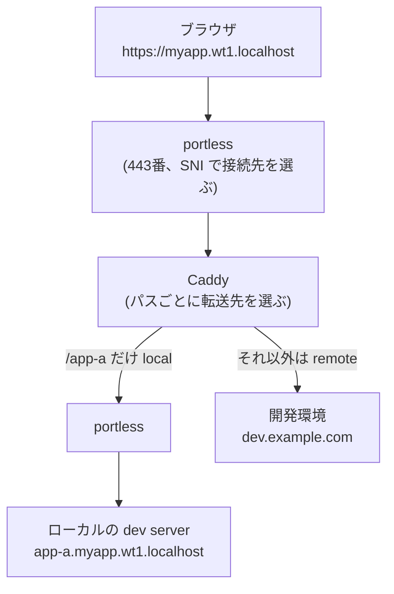
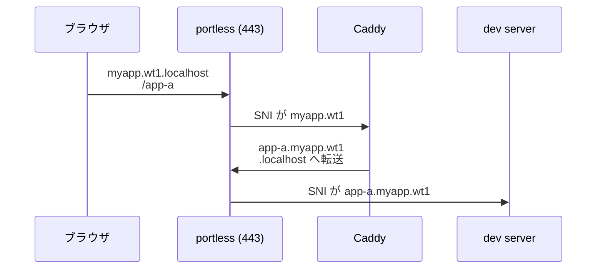

仕事で開発している Web プロダクトは、複数のミニアプリをパスで分けて 1 つのドメインから配信しています。
`/app-a` はアプリ A、`/app-b` はアプリ B、`/api` は API ゲートウェイ、という構成です。

以前は、フロントエンドを 1 行直して画面で確かめるだけでも、ローカルにバックエンドのコンテナ一式を立てる必要がありました。
今は、ローカルで動かすのは触っているフロントエンドの dev server だけで、残りは共有の開発環境（以下 `dev.example.com`）に転送しています。
この記事はその仕組みの解説です。



図は、ブラウザから見えるのは `https://myapp.wt1.localhost` の 1 つだけで、その裏で Caddy がパスごとにローカルとリモートを選んでいることを示しています。
`wt1` は git worktree の名前です。

## 何を切り替えられるか

`.env` に、パスごとの転送先を 1 行ずつ書きます。

```env
CADDY_PROXY_API=remote_auth dev.example.com
CADDY_PROXY_APP_A=local app-a
```

この 2 行で「アプリ A だけローカル、API は開発環境」になります。
書かなかったパスは `remote dev.example.com` に向きます。
QA 環境の API に向けたいときは `CADDY_PROXY_API=remote_auth qa.example.com` に変えるだけです。

書式は `CADDY_PROXY_<対象>=<mode> <target>` で、mode は 4 つあります。

- `local`: ローカルの dev server へ転送する。target は portless のアプリ名で、`<アプリ名>.myapp.<worktree>.localhost` に展開する
- `local_host`: `local` と同じだが、target にホスト名をそのまま書く
- `remote`: リモートの環境へ HTTPS で転送する
- `remote_auth`: `remote` に加えて、認証トークンを `Authorization` ヘッダーに付ける。API のパスで使う

## API の向き先を環境変数で変えるだけでは足りない理由

フロントエンドの設定で API の URL を `https://dev.example.com/api` に向ける方法もあります。
この方法では、ページのオリジンが `localhost:3000`、API のオリジンが `dev.example.com` と別になります。
そのため CORS の許可、Cookie の送信、ログイン後のリダイレクト先が本番と違う動きになり、それぞれに開発用の設定が要ります。

Caddy を前に置くと、ブラウザから見たオリジンは `https://myapp.wt1.localhost` の 1 つになります。
ページも API も同じオリジンから返るので、本番と同じく CORS は発生せず、Cookie もそのまま送られます。
アプリ間のリンクも `/app-b` のような相対パスのまま動きます。

## portless: worktree ごとに HTTPS の URL を分ける

[portless](https://portless.sh) は、ローカルの dev server に `https://<名前>.localhost` という URL を付けるツールです。
443 番ポートで HTTPS のプロキシを起動し、リクエストのホスト名（TLS の SNI）を見て、どのプロセスに渡すかを決めます。
各プロセスのポート番号は portless がランダムに割り当てます。

dev server は次のように起動しています。

```bash
portless app-a.myapp.$(basename $(git rev-parse --show-toplevel)) pnpm dev
```

worktree の名前をホスト名に入れているのは、複数の worktree で同時に開発するためです。
ポート番号を固定していると、2 つ目の worktree で dev server を起動したときにポートが衝突します。
portless ではホスト名が worktree ごとに変わり、ポートは自動で割り当てられるので衝突しません。
ドメインが別になるので、worktree 間で Cookie や localStorage も混ざりません。

ローカル用の CA 証明書も portless が作ってシステムに登録するので、ブラウザの警告なしに HTTPS で開けます。

## Caddy も portless の中で起動する

Caddy 自体も portless でくるんで起動しています。

```bash
portless myapp.wt1 caddy run --config Caddyfile --envfile .env
```

こうすると、Caddy にも `https://myapp.wt1.localhost` という入り口が付きます。
Caddy が待ち受けるポートは portless が割り当てるので、worktree ごとに Caddy を起動してもぶつかりません。

そのため、`local` を選んだパスのリクエストは portless を 2 回通ります。



図は、Caddy がローカルの dev server をポート番号ではなくホスト名で指定していることを示しています。
Caddyfile に dev server のポート番号を書かずに済むのは、この経路のおかげです。

## Caddyfile の 4 つのスニペット

Caddyfile では、mode ごとにスニペットを定義し、`.env` の値でどれを読み込むかを選んでいます。

```caddy
:{$PORT} {
  handle /api/* {
    import {$CADDY_PROXY_API:remote_auth dev.example.com}
  }
  handle /app-a* {
    import {$CADDY_PROXY_APP_A:remote dev.example.com}
  }
  handle {
    import {$CADDY_PROXY_MAIN:remote dev.example.com}
  }
}
```

`import` の引数に環境変数をそのまま渡しています。
`CADDY_PROXY_APP_A=local app-a` なら `import local app-a` と同じになり、`local` スニペットの `{args[0]}` に `app-a` が入ります。
環境変数が無いときは `:` の後ろの既定値が使われます。

### local: Host と Origin を書き換える

```caddy
(local) {
  reverse_proxy https://{args[0]}.myapp.{$WORKTREE_NAME}.localhost {
    header_up Host {upstream_hostport}
    header_up Origin https://{upstream_hostport}
    transport http {
      tls
      tls_insecure_skip_verify
    }
  }
}
```

ブラウザが送る `Origin` は `https://myapp.wt1.localhost` です。
Next.js の dev server は、HMR の WebSocket 接続で自分のアドレス以外の Origin を拒否します。
そこで Caddy が `Host` と `Origin` を転送先のホスト名に書き換え、dev server からは自分宛ての接続に見えるようにしています。
あわせて `next.config.ts` の `allowedDevOrigins` にも portless のドメインを足しています。

`tls_insecure_skip_verify` を付けているのは、転送先の証明書が portless のローカル CA で署名されているからです。
Caddy は Docker の中で動かすこともあり、その場合はホストに登録した CA をコンテナから参照できないので、証明書の検証を外しているのだと思います。

### remote: SNI とリダイレクト先を合わせる

```caddy
(remote) {
  reverse_proxy https://{args[0]} {
    header_up Host {upstream_hostport}
    header_down Location "https://{args[0]}" "{$PORTLESS_URL}"
    transport http {
      tls_server_name {args[0]}
    }
  }
}
```

`tls_server_name` と `Host` の書き換えで、開発環境のサーバーには `dev.example.com` 宛てのリクエストとして届きます。
`header_down Location` は、開発環境が返すリダイレクト先 `https://dev.example.com/...` を `https://myapp.wt1.localhost/...` に書き換えます。
これが無いと、ログイン後などのリダイレクトでブラウザが開発環境のドメインへ移ってしまい、ローカルのフロントエンドに戻ってきません。
クエリ文字列の中に URL エンコードされたリダイレクト先が入る場合に備えて、エンコード済みの文字列も同じように書き換えています。

### remote_auth: API にだけトークンを付ける

`remote_auth` は `remote` に次の 1 行を足したものです。

```caddy
header_up Authorization "Bearer {$GATEWAY_JWT}"
```

開発環境の API ゲートウェイは認証済みのリクエストしか受け付けません。
そこで、ローカルで一度ログインして取ったアクセストークンを、Caddy が `/api/*` へのリクエストにだけ付けています。

- `make login` で、ネイティブアプリ用のログイン（Authorization Code Flow + PKCE）を通してトークンを取り、ホームディレクトリのファイルに保存する
- `make caddy-up` が起動時にトークンを更新し、環境変数 `GATEWAY_JWT` として Caddy に渡す
- アクセストークンは 2 時間で失効するので、常駐スクリプトが失効の 5 分前に Caddy を再起動して、新しいトークンを渡し直す

トークンを付けるのは API のパスだけです。
フロントエンドのアセットを返すパスには付けません。

## 起動の手順

開発者がやることは 3 つです。

1. `.env` で触るアプリだけを `local` にする
2. そのアプリの dev server を `pnpm --filter <アプリ> portless-dev` で起動する
3. `make caddy-up` で Caddy を起動し、`https://myapp.<worktree>.localhost/app-a` を開く

`make caddy-up` は、`caddy` コマンドが手元にあればそれを使い、無ければ Docker で起動します。
接続先の変更は Claude Code の skill にしてあり、「アプリ A をローカル、API は QA 環境」と伝えると `.env` の書き換えから再起動までを実行します。
