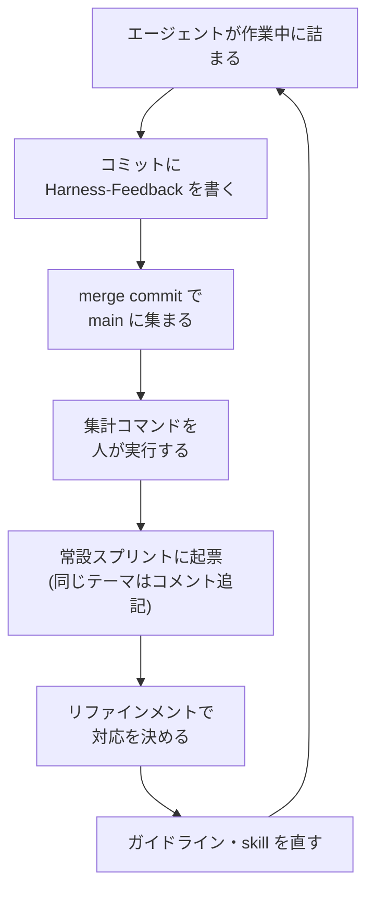

チーム開発で、AI エージェント向けのハーネス(AGENTS.md・skill・ガイドライン)を整備しています。今回は、ハーネスへのフィードバックをコミットトレーラーで集めて改善につなげるループを組み、2 か月回してみたというお話です。

先にループの全体を置きます。



図のうち、人の手が要るのは「集計コマンドを人が実行する」と「リファインメントで対応を決める」の 2 か所です。

## なぜ作った人にフィードバックが届かないのか

ハーネスを作る人と使う人は別です。チームの誰かが書いた skill やガイドラインを、ほかのメンバーのエージェントが毎日読んでいます。

ハーネスの不具合に最初に気づくのは、たいてい人ではなくエージェントです。たとえば、2 つのガイドラインが同じ命名について逆のことを書いていると、エージェントはどちらかを選んで進めます。そのとき「矛盾していた」という気づきはそのセッションの中にしかなく、セッションが終わると消えます。

人が気づいた場合でも、1 行で済む指摘のために Slack や issue へ書きに行く人は多くありません。作業の手を止めて別のツールに切り替える必要があるからです。結果として、作った人の手元には「誰も困っていない」ように見える状態が残ります。

skill の棚卸しにも同じ問題がありました。skill は増えるほど name と description がコンテキストを圧迫するので削りたいのですが、どの skill がどれだけ使われているかのデータがありませんでした。

## コミットトレーラーに書かせる

報告のための手順を増やさずに済む場所として、コミットメッセージを選びました。エージェントは作業の最後に必ずコミットを作るので、その末尾に git の trailer(`Key: value` の行)を足すだけなら手順は増えません。

AGENTS.md に次の 4 種類を書くよう指示しています。

- `Used-Model`: コミットを作った AI モデル。AI のコミットには常に付ける。特定できなければ `unknown`
- `Used-Harness`: 実行環境(`claude-code`、`claude-code-cloud`、`codex-cloud`、`cursor` など)。常に付ける
- `Used-Skills`: その作業で有効化した skill。使っていなければ付けない
- `Harness-Feedback`: ガイドラインの不足・誤りや、skill が期待通りに動かなかった点。気づきがあったときだけ 1 行で付ける

実際のコミットはこんな感じになります(内容は架空です)。

```text
fix: 予定一覧の空表示のアイコンを差し替える

(本文)

Used-Model: claude-opus-5-5
Used-Harness: claude-code
Used-Skills: frontend-guideline
Harness-Feedback: components.md と hooks.md でイベントハンドラの命名規則が逆になっていて、どちらに従うか判断できなかった
```

`Used-Model` を `Co-Authored-By` と別に持つのは、`Co-Authored-By` を残さない CLI があるからです。AI コミットの数(集計の分母)を CLI に依存せずに揃えるために独立させました。

## 収集の仕組みは作らない

私たちのリポジトリは squash せずに merge commit で取り込むので、ブランチ上の個々のコミットが trailer ごと main に残ります。全員のエージェントが書いた trailer は、何もしなくても main の履歴に集まります。

集計は git の標準機能だけで書けます。

```bash
# フィードバック一覧(直近 1 か月)
git log --since='1 month ago' --format='%h %(trailers:key=Harness-Feedback,valueonly)' | awk 'NF>1'

# skill 別の利用回数(直近 1 か月)
git log --since='1 month ago' --format='%(trailers:key=Used-Skills,valueonly)' \
  | tr ',' '\n' | sed 's/^ *//;/^$/d' | sort | uniq -c | sort -rn
```

squash merge のリポジトリでは個々のコミットが main に残らないので、この方法はそのままでは使えません。

導入前に、trailer のことを知らせずに「小さな変更をしてコミットして」とだけ頼んだ別のエージェント(Sonnet)で試しました。エージェントは AGENTS.md の指示だけを読んで `Used-Skills` を付けました。Codex は手元で試せなかったので、main に入った Codex のコミット 58 件を調べました。AGENTS.md の「コミットメッセージは日本語」という規約に従っていたのは 56 件で、AGENTS.md の指示は Codex にも届いていると判断しました。

## 自己申告なので割り切ったこと

trailer はエージェントの自己申告です。人のコミットも混ざるので、commit-msg hook で必須にはできません。記録漏れは必ず出る前提で、次のように扱いを決めました。

- `Harness-Feedback` は 1 件ごとに独立して価値があるので、漏れても失うのはその 1 件だけ。配送の保証はしない
- skill の利用回数が 0 件でも削除の根拠にしない。Slack で使っている人がいないか確認してから棚卸しの PR を出す
- レビュー系や調査系の skill はコミットに至らない作業で使われるので、使われていても構造的に 0 件に近くなる。利用回数は同じ種類の skill 同士でだけ比べる
- 個人やチームの評価には使わない。評価に使うと申告の仕方が変わり、ハーネス改善のデータとして使えなくなる

## 起票までを半自動にする

集計と起票はリポジトリ内のコマンドにしました。人が `/harness-observability` を実行すると、エージェントが次の作業をします。

1. git log から直近 30 日の trailer を集計し、skill 別の利用回数・trailer の記録率・フィードバック一覧を出す
2. フィードバックごとに、Jira の常設スプリント「ハーネスフィードバック」に同じテーマの未完了チケットがあるか探す
3. あればそのチケットに再発としてコメントを足し、なければ新しく起票してスプリントに入れる

起票されたチケットは、もともとあったリファインメントで対応するかを決めます。トリアージのための会議は新しく作っていません。

## 2 か月回した結果

2026-08-19 に導入し、2026-10-19 時点の数字です。

| 項目 | 数値 |
| --- | --- |
| AI のコミット(`Used-Model` 付き) | 586 件 |
| `Harness-Feedback` 付きのコミット | 16 件(書いた人は 10 人) |
| 直近 30 日の `Used-Harness` の付け漏れ | 0 件(203 件中) |
| 直近 30 日の `Used-Skills` の記録率 | 89%(181 / 203 件) |
| コマンドで起票したチケット | 4 件(完了 2・見送り 1・未着手 1) |

集まったフィードバックを種類で分けると、次のようになります。

- ガイドライン同士の矛盾(同じ矛盾を別の日に 2 回指摘されている)
- 移動済みのファイルのパスを参照していた
- テストの実行に必須のオプションが文書に書かれていない
- 補助スクリプトが特定の条件で落ちる、自動修正が通知なしにコードを消した
- 名前の似た skill を取り違えて呼んでしまう
- 表の列を、ブラウザで開く URL と誤読した
- サンドボックスの制約でチェックアウトが途中で失敗し、復旧に手数がかかった
- 共通コンポーネント自体の不具合

どれも、作業した人が自分から Slack に書くことは少なそうな 1 行の指摘です。
