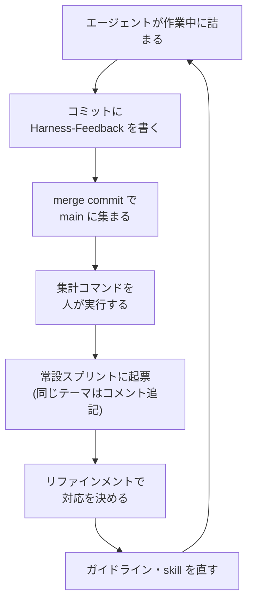

チーム開発で、AI エージェント向けのハーネス（AGENTS.md・skill・ガイドライン）を整備しています。

今回は、ハーネスへのフィードバックをエージェントにコミットトレーラーとして書かせ、作った人の手元に集めるようにしたというお話です。



図のうち、人の手が要るのは「集計コマンドを人が実行する」と「リファインメントで対応を決める」の 2 か所です。
それ以外は、エージェントがいつもの作業の中で済ませます。

## なぜ作った人にフィードバックが届かないのか

ハーネスを作る人と使う人は別です。
チームの誰かが書いた skill やガイドラインを、ほかのメンバーのエージェントが毎日読んでいます。

ハーネスの不具合に最初に気づくのは、たいてい人ではなくエージェントです。
たとえば、2 つのガイドラインが同じ命名について逆のことを書いていると、エージェントはどちらかを選んで進めます。
そのとき「矛盾していた」という気づきはそのセッションの中にしかなく、セッションが終わると消えます。

人が気づいた場合でも、1 行で済む指摘のために Slack や issue へ書きに行く人は多くありません。
作業の手を止めて別のツールに切り替える必要があるからです。
結果として、作った人の手元には「誰も困っていない」ように見える状態が残ります。

## コミットトレーラーに書かせる

報告のための手順を増やさずに済む場所として、コミットメッセージを選びました。
エージェントは作業の最後に必ずコミットを作るので、その末尾に git の trailer（`Key: value` の行）を 1 行足すだけなら、別のツールに切り替える必要はありません。

AGENTS.md には次のように書いています。

- `Harness-Feedback: <1 行>`: ガイドラインの不足・誤りや、skill が期待通りに動かなかった点など、ハーネスの改善につながる気づきがあったときだけ付ける

実際のコミットはこんな感じになります（内容は架空です）。

```text
fix: 予定一覧の空表示のアイコンを差し替える

(本文)

Used-Model: claude-opus-5-5
Used-Harness: claude-code
Used-Skills: frontend-guideline
Harness-Feedback: components.md と hooks.md でイベントハンドラの命名規則が逆になっていて、どちらに従うか判断できなかった
```

`Harness-Feedback` 以外の 3 つも一緒に付けさせています[^1]。
こちらはハーネスの利用状況を見るためのもので、この記事では扱いません。

### AGENTS.md の数行で足りるか

指示が AGENTS.md の数行だけで足りるかは、導入前に確かめました。
trailer のことを知らせずに「小さな変更をしてコミットして」とだけ頼んだ別のエージェント（Sonnet）は、AGENTS.md の指示だけを読んで trailer を付けました。

Codex は手元で試せなかったので、main に入った Codex のコミット 58 件を調べました。
AGENTS.md の「コミットメッセージは日本語」という規約に従っていたのは 56 件で、Codex も AGENTS.md の指示に従っていると判断しました。

## 収集の仕組みは作らない

私たちのリポジトリは squash せずに merge commit で取り込むので、ブランチ上の個々のコミットが trailer ごと main に残ります。
全員のエージェントが書いたフィードバックは、何もしなくても main の履歴に集まります。

一覧は git の標準機能だけで出せます。

```bash
git log --since='1 month ago' --format='%h %(trailers:key=Harness-Feedback,valueonly)' | awk 'NF>1'
```

ただし、squash merge のリポジトリでは個々のコミットが main に残らないので、この方法はそのままでは使えません。

## 起票までを半自動にする

集計と起票はリポジトリ内のコマンドにしました。
人がコマンドを実行すると、エージェントが次の作業をします。

1. git log から直近 30 日の `Harness-Feedback` を一覧にする
2. フィードバックごとに、Jira の常設スプリント「ハーネスフィードバック」に同じテーマの未完了チケットがあるか探す
3. あればそのチケットに再発としてコメントを足し、なければ新しく起票してスプリントに入れる

起票されたチケットは、もともとあったリファインメントで対応するかを決めます。

## 自己申告なので割り切ったこと

trailer はエージェントの自己申告です。
気づきがあったかどうかは外から判定できないので、commit-msg hook で付け忘れを検出することもできません。

記録漏れは出る前提で、次の 2 つを決めました。

- 配送の保証はしない。フィードバックは 1 件ごとに独立して価値があるので、漏れても失うのはその 1 件だけです
- 個人やチームの評価には使わない。評価に使うと申告の仕方が変わり、ハーネス改善のデータとして使えなくなります

## 集まったもの

2026-08-19 から 2026-10-19 までの 2 か月の数字です。

| 項目 | 数値 |
| --- | --- |
| AI のコミット（`Used-Model` 付き） | 586 件 |
| `Harness-Feedback` 付きのコミット | 16 件 |
| フィードバックを書いた人 | 10 人 |
| 直近 30 日の `Used-Harness` の付け漏れ | 0 件（203 件中） |
| コマンドで起票したチケット | 4 件（完了 2・見送り 1・未着手 1） |

`Used-Harness` は AI のコミットに常に付ける trailer です。
この付け漏れの数を見ると、エージェントが AGENTS.md の trailer の指示に従っているかが分かります。

集まったフィードバックを種類で分けると、以下の通りです：

- ガイドライン同士の矛盾（同じ矛盾を別の日に 2 回指摘されている）
- 移動済みのファイルのパスを参照していた
- テストの実行に必須のオプションが文書に書かれていない
- 補助スクリプトが特定の条件で落ちる、自動修正が通知なしにコードを消した
- 名前の似た skill を取り違えて呼んでしまう
- 表の列を、ブラウザで開く URL と誤読した
- サンドボックスの制約でチェックアウトが途中で失敗し、復旧に手数がかかった
- 共通コンポーネント自体の不具合

どれも、作業した人が自分から Slack に書くことは少なそうな 1 行の指摘です。

## まとめ

- エージェントのコミットに `Harness-Feedback` trailer を書かせた
- merge commit で main に集まるフィードバックを git log で一覧にし、常設スプリントへ起票するコマンドを作った
- 対応するかは、もともとあったリファインメントで決める

2 か月で、10 人のコミット 16 件分の指摘がハーネスを作った側の手元に届きました。

[^1]: `Used-Model` はモデル名、`Used-Harness` は Claude Code や Cursor などの実行環境、`Used-Skills` は使った skill です。
