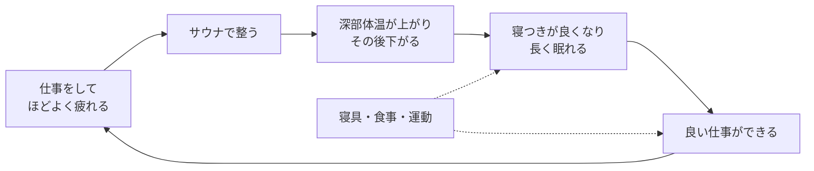

AI を使って仕事をするようになってから、私が 1 日にこなす仕事の量と密度は上がりました。

今回は、私が先に個人で回してきた、仕事・サウナ・睡眠・食事の循環のお話です。
個々の健康法に加えて、AI で労働強度が上がるこれからは「仕事のパフォーマンスを出すための健康」が働く人全般の関心事になる、という予測まで書いてみようと思います。

私が今やっていることは以下の通りです：

- サウナに毎日入る
- 寝具（ベッド・枕・掛け布団・カバー）にお金をかける
- グルテンと乳製品を避ける
- 自重トレーニングをして、肉・キノコ・ニンニクを取る

## 循環の全体像

図は、仕事がサウナの前提になり、サウナが睡眠の前提になり、睡眠が次の仕事の前提になることを示しています。
輪になっているので、どこから始めても循環に入れます。

### 仕事とサウナ

サウナには毎日入っています。
よく整うには、ある程度疲れている必要があります。その疲れをつくるのに、仕事がちょうどよい量になっています。

### サウナと睡眠

サウナから睡眠へのつながりは、深部体温で説明できると考えています。

サウナに入ると深部体温が上がります。
一般的なフィンランド式（10 分×4 回）の実測では平均 +0.4℃ で[^1]、高温や長時間の条件では +1.2〜1.4℃ まで上がります[^2]。

就寝 1〜2 時間前に 40〜42.5℃ のお湯に入ると、寝つくまでの時間が短くなることがメタ分析で分かっています[^3]。
手のひらや足の裏から熱が逃げて、深部体温が下がるためと考えられています。

ただし、サウナと睡眠を直接比べた研究は見つけられませんでした。
サウナで寝つきが良くなるというのは、入浴の研究からの類推と、私の体感です。

## 循環を支える部品

### 睡眠: 寝具への投資

睡眠には本当にお金をかけています。

- ベッド: アクティブスリープ
- 枕と掛け布団: エアウィーブ
- 枕と掛け布団のカバー: シルク

カバーをシルクにしてから、睡眠時間を長く取れるようになりました。
アクティブスリープのアプリの記録でも増えています。

私は、多くの人の睡眠の質はすでに十分で、差がつくのは時間だと考えています。

### 食事: 出口から考える

食事は、出口から考えています。つまり排便です。
食べたものがどう出るかを見て、自分の胃腸に合わないものを外しています。

たとえば、今はグルテンフリーにしていて、乳製品も避けています。
何が合うかは体質によって違うので、時間をかけて 1 つずつ試して選びました。

腸内細菌と脳の関係は研究が進んでいます。
特定の腸内細菌とうつの間に関連が見つかっていて[^4]、うつ病の人の腸内細菌をラットに移すとうつのような行動が出たという実験もあります[^5]。
ただし、健康な人の仕事のパフォーマンスを腸内細菌が変えると示した研究は、見つけられませんでした。

### 運動: 自重トレーニング

運動は自重トレーニングだけにしています。
筋肉は大事です。ただ、デスクワーカーの私は、部位ごとに細かく鍛えることも限界までの筋肥大も求めていません。それならジムに行く必要はなく、自重で十分です。

一般的なデスクワーカーなら、自重トレーニングでほとんど足りるというのが私の結論です。

### テストステロン

もう 1 つの目的はテストステロンで、食事でも肉・キノコ・ニンニクを取るようにしています。
きっかけは牛尾剛さんの『世界一流エンジニアの思考法』[^book]です。6 章に、運動と食事（肉、玉ねぎ、加熱したニンニク）でテストステロンを増やす話が出てきます。

研究では、筋トレの直後にテストステロンは一時的に上がりますが、短時間で戻ります[^6]。
11 の RCT（421 人）のメタ分析では、運動による安静時の値の変化は見られませんでした[^7]。

## なぜ働く人全般に広がると考えるのか

### 労働強度が上がると、睡眠を削れなくなる

1 晩 6 時間の睡眠を 2 週間続けた人は、2 晩徹夜した人と同じくらい認知課題の成績が下がりました。しかも本人は、眠気の悪化にほとんど気づきませんでした[^8]。

AI で仕事の量と密度が上がっても、睡眠を削って量をこなすことはできません。
強度が上がるほど、回復の側の質を上げなければ仕事の質を保てません。

### 先に始まっている体の管理

競争の激しい環境では、すでに体の状態を仕事のために管理し始めています。
たとえば、2023 年にはシリコンバレーの創業者やエンジニアが血液検査でテストステロンの値を測り、生活習慣やサプリで上げようとする集まりが報じられました[^9]。

米国では、テストステロン補充療法の処方を受けた人が 2018 年から 2022 年に 27% 増え、35〜44 歳では 58% 増えています[^10]。

※ 補充療法は注射やパッチを使う医療行為で、私は使っていませんし、勧めるつもりもありません。ここでは、関心が広がっている例として挙げています

## さいごに

私が回している循環は以下の通りです：

- 仕事で疲れ、サウナで整い、長く眠る循環を毎日回す
- 寝具にお金をかけて、睡眠時間を確保する
- 胃腸に合わないものを、1 つずつ試して外す
- 自重トレーニングと食事で、テストステロンを意識する

AI で労働強度が上がる人が増えるほど、私が個人で回してきたような「パフォーマンスのための健康」への関心も広がり、健康ブームのような形で表に出てくると考えています。

[^1]: Laatikainen-Raussi et al. (2026). Temperature. https://pubmed.ncbi.nlm.nih.gov/42694940/
[^2]: Pilch W et al. (2013). Journal of Human Kinetics. https://pubmed.ncbi.nlm.nih.gov/24511348/ / Jenkins et al. (2026). Experimental Physiology. https://pubmed.ncbi.nlm.nih.gov/42533687/
[^3]: Haghayegh S et al. (2019). Before-bedtime passive body heating by warm shower or bath to improve sleep. Sleep Medicine Reviews 46:124-135. https://doi.org/10.1016/j.smrv.2019.04.008
[^4]: Valles-Colomer M et al. (2019). The neuroactive potential of the human gut microbiota in quality of life and depression. Nature Microbiology. https://pubmed.ncbi.nlm.nih.gov/30718848/
[^5]: Kelly JR et al. (2016). Transferring the blues. Journal of Psychiatric Research. https://pubmed.ncbi.nlm.nih.gov/27491067/
[^book]: 牛尾剛 (2023). 『世界一流エンジニアの思考法』文藝春秋. 6 章
[^6]: Hooper DR et al. (2017). Sports Medicine. https://pubmed.ncbi.nlm.nih.gov/28224307/
[^7]: Potter NJ et al. (2021). Journal of Strength and Conditioning Research. https://pubmed.ncbi.nlm.nih.gov/35134000/
[^8]: Van Dongen HPA et al. (2003). The cumulative cost of additional wakefulness. Sleep 26(2):117-126. https://pubmed.ncbi.nlm.nih.gov/12683469/
[^9]: The Information. Inside Silicon Valley's New Boys Club: The Testosterone-Testing 'T Party'. https://www.theinformation.com/articles/inside-silicon-valleys-new-boys-club-the-testosterone-testing-t-party / SF Standard (2023-08-26). https://sfstandard.com/2023/08/26/san-francisco-tech-bros-host-testerone-testing-parties-is-it-junk-science/
[^10]: Selinger & Thallapureddy (2024). PLoS One. https://pubmed.ncbi.nlm.nih.gov/39196907/
