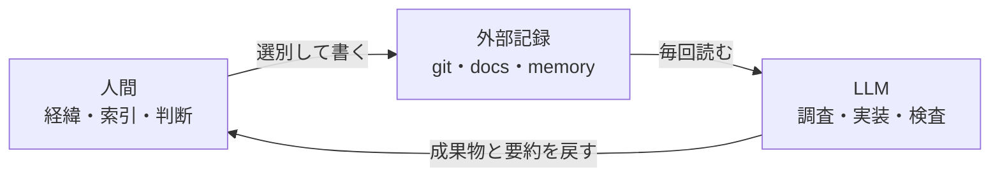
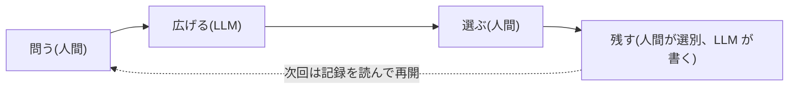
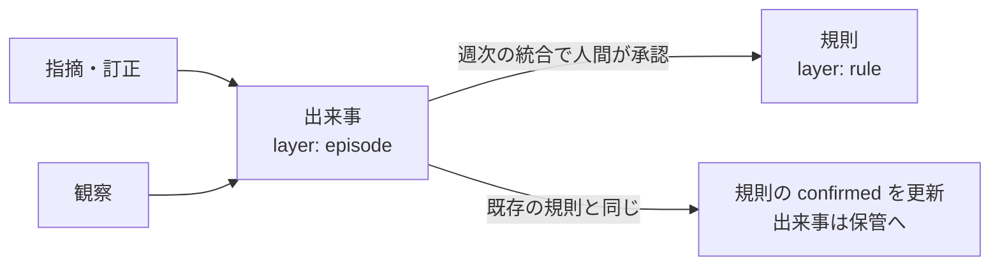
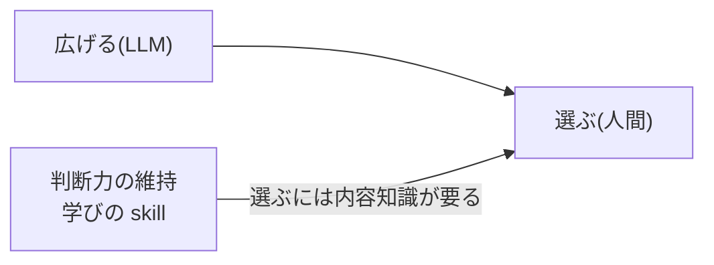

最近、LLM と一緒に仕事をする仕組みを考えて、Claude Code の上に少しずつ作っています。出発点は「長期記憶の人間、短期記憶の LLM」という見立てでした。考えるうちに分担の軸が変わり、軸に合わせて部品を 4 つ作りました。

この記事はその全体像です。部品の大半は 2026-10-15 から 17 日に作り、運用は数日しかしていません。そのため節ごとに、作ったものと、まだ測っていないものを分けて書きます。

## 全体像

人間と LLM の間に外部の記録を挟み、三者で分担します。



図が示しているのは、内容を持つのは記録で、人間は記録のどこに何があるかと判断を持つ、という分担です。この分担を 4 つの部品で組みました。

1. 四段階の循環
   - 問う → 広げる → 選ぶ → 残す を、人間と LLM で交互に担う
2. 記録の置き場
   - 情報の性質で置き場を決める
3. 記録を外す操作
   - 増え続ける記録を、LLM が読む対象から外す。人間の忘却の仕組みを写した。人間側の仕組みは[「忘れた」は 6 つの別の出来事](/blog/forgetting-is-six-events/)に書いた
4. 判断力の維持
   - 人間が LLM のもっともらしい誤りを見抜ける状態を保つ。理解の測り方は[流暢性バイアスに囚われない、予測差分から導く真の理解](/blog/fluency-vs-diff/)に書いた

## 分担の軸を置き直す

「長期記憶の人間、短期記憶の LLM」は、人間に内容を覚えさせる分担に読めます。ところが人間の長期記憶は、内容については不正確です。覚えているのは経緯と「どこに何があったか」で、細部は思い出すたびに変わります。LLM は逆に、セッションをまたいで何も持ち越さない代わりに、一時点で数十万 token を読めます。

そこで、比べる観点を増やして並べ直しました。

| 観点 | 人間 | LLM |
| --- | --- | --- |
| 時間をまたぐ連続性 | 持つ | 持たない |
| 一時点で扱える幅 | 7 項目前後 | 数十万 token |
| 何を大事にするかの決定 | できる | 与えられたものに従う |
| 世界で確かめる | 人に聞く・行く・触る | できない |
| 反復・形式変換・照合 | 疲れる、抜ける | 一定の品質で続く |
| 誤りの出方 | 忘れる、思い込む | もっともらしく間違える |

分担の軸は「時間をまたぐ連続性」対「一時点で扱える幅」になります。内容は記録に置き、LLM が毎回そこから読み直します。人間は記録の索引と判断を持ち、仕事が途切れずに続いていることを確かめる役に回ります。

この見方は既存の枠組みとも合います。Hutchins の分散認知は、認知を人間・道具・記録を合わせた系全体で捉えます。この見方なら LLM も系の 1 要素として置けます。Wegner の transactive memory は、チームが「誰が何を知っているか」を分担して覚えることを示しました。LLM と組むと、人間が覚える対象は「どのファイルが何を知っているか」に変わります。

## 部品 1: 四段階の循環

PR レビュー・新しいコードベースに入る・旅行の計画の 3 つの場面を比べると、同じ型が出てきました。



図は、人間と LLM が交互に担う 1 回分の循環です。人間が担う「問う」「選ぶ」「残すものの選別」は、どれも何を大事にするかの決定を含みます。LLM が担う「広げる」「書く」は、一時点の幅と反復で済む作業です。

プロダクトも学習も終わらずに続くので、この循環は 1 回の寄与にあたります。LLM のセッションは、続いているものの状態を読み、1 回分の変化を加え、記録に書き戻して終わります。次のセッションの品質は、入口で何を読み、出口で何を残したかで決まります。中身の作業より、セッションの境界の設計に時間を使う理由はここにあります。

## 部品 2: 記録の置き場

置き場は、情報が変わるかどうかと、文書にできるかどうかで決めます。

1. 変わらない規範
   - lint など機械の判定に置く。LLM に読ませる必要自体をなくす
   - 例: lint にした規約は、ガイドラインの文書から消した
2. 変わるが文書にできるもの
   - docs と skill に置き、条件が合ったときだけ読ませる
3. 経緯
   - ADR・PR・memory に置き、問いが立ったときに検索させる
4. 判断
   - 人間に残す

## 部品 3: 記録を外す操作

人間は放っておいても忘れるので、重要なものだけが残ります。記録は意図的に外さない限り増え続け、やがて一時点で読める幅を超えます。

### 捨てるのではなく、読む層を下げる

外すといっても保管から消すわけではありません。LLM が読む対象には層があり、外す操作は記録を 1 段下の層に移す降格です。

| 層 | 例 | 読まれるとき | 毎セッションのコスト |
| --- | --- | --- | --- |
| 常時 | CLAUDE.md・memory の索引 | 必ず | 全文分 |
| 条件 | skill・ガイドライン・memory 本文 | 条件が合ったとき | 合ったときだけ |
| 検索 | 社内ドキュメント・ADR・PR・git log | 問いが立ったとき | ほぼゼロ |
| 保管 | git 履歴・アーカイブ | 掘り返すとき | ゼロ |

手元の道具をこの表に置くと、記録を上に入れる操作はそろっていました。LLM は memory を書き、人間は skill を作ります。一方で、下に移す操作は 1 つもありませんでした。

### 読まれていない記録を数える

降格を判断するには、どの記録が読まれていないかを知る必要があります。まず直近 30 日のセッションログ 95 件を grep し、職場のリポジトリの memory 64 件それぞれの名前が何件のセッションに出たかを数えました。

| 30 日間に名前が出たセッション数 | 件数 |
| --- | --- |
| 0 | 36 |
| 1 | 25 |
| 2 以上 | 3 |

この数字には限界が 2 つあります。grep は作ったセッションも 1 件と数えるので、1 件の 25 本は作ったときにしか触っていない可能性があります。また、そのリポジトリでのセッションは 30 日で 11 本しかなく、0 件を不要と読むには参照の機会が少なすぎます。

そこで、読んだ事実だけを残す hook を置きました。

- きっかけ: PostToolUse の `Read|Skill|Bash`
- 条件: 対象のパスが memory か skills の配下
- 記録: `read-log.tsv` に日付・セッション・ディレクトリ・ツール・パスの 5 列を 1 行追記

Bash を含めたのは、許可確認を省くモードのセッションでは memory を `cat` で読むためです。そのぶん Bash 由来の行は読み込みと書き込みを区別できないので、後で重みを下げて数えます。

### 月 1 回の棚卸し

降格のきっかけは 5 つにしました。

1. 期限: チケットが閉じた、プロジェクトが終わった
2. 代替: lint・skill・コードに置き換わった
3. 統合: 同じ領域の事例が複数たまった
4. 未参照: 一定期間読まれていない
5. 移管: そもそもこのプロジェクトの話ではない

LLM が候補と理由を列挙し、人間が「残す・縮める・落とす」を選ぶ skill を作りました。縮めるは、経緯を 1 行にして本体へのリンクを残すことです。落とすは memory から外すことで、ファイルはアーカイブに移し削除しません。降格したものを索引に戻す経路も残しています。

職場のリポジトリで初回の棚卸しをした結果です。

| 操作 | 件数 |
| --- | --- |
| 落とす | 8 |
| 縮める | 21 |
| 移管 | 6 |
| 索引の行数 | 64 → 29 |

棚卸しで分かったことが 2 つあります。

- 64 件の 4 分の 1 は、そのリポジトリの話ではありませんでした。個人の skill、別リポジトリ、OS の癖の話です。memory の置き場は、何についての記録かではなく、どのディレクトリで Claude Code を開いたかで決まります。5 つ目のきっかけの移管は、この結果を見て足しました
- project 型の半分は「レポートは社内ドキュメントの何番」というリンクでした。検索層に置くべきものが条件層に入っていた形です。今は書く時点で「本体が別の場所にあるなら memory には 1 行だけ書く」と CLAUDE.md で決めています

その後、棚卸しを段階制にすると決めました。明らかに不要なものは LLM が外し、判断に迷うものだけ人間に聞く形です。どれを LLM に任せるかの規則は、人間が「この種類は聞かなくていい」と答えるたびに足していきます。規則には決めたときのモデル名を書き、モデルが変わるか半年たったら見直します。段階制はまだ skill に入れていません。

## 部品 3 の続き: 人間の忘却から借りた 3 つの hook

棚卸しを作った後で、人間の忘却の仕組みと並べ直しました。保存と検索を分ける、事例を要旨にまとめる、といった部分はすでに写せていました。写せていなかったのは次の 3 点です。

| 人間の仕組み | 写す前 | 置いた hook | 動くとき |
| --- | --- | --- | --- |
| 頻度と新しさによる減衰 | 30 日で 0 回かどうかの二値 | 活性度の計算 | 月次の棚卸し |
| 似た記憶どうしの干渉 | 月 1 回の統合だけ | 似た memory の検出 | memory を書いた直後 |
| 思い出したときの書き換え(再固定化) | 読んだ事実だけを記録 | 確かめ直しの促し | memory を読んだ直後 |

### 減衰: 活性度で順位を付ける

認知アーキテクチャ ACT-R の base-level activation を使い、頻度と新しさを 1 つの数にしました。

```text
B = ln( Σ t_j ^ -d )
  t_j : j 回目のアクセスからの日数(下限 0.5 日)
  d   : 減衰指数。memory の type ごとに変える
```

| type | d(仮置き) | 意図 |
| --- | --- | --- |
| user | 0.3 | 本人についての記録は遅く落とす |
| feedback | 0.4 | 訂正は人間でも長く残る |
| project | 0.5 | 標準 |
| reference | 0.5 | 標準 |

アクセスの重みは Read と Skill を 1.0、Bash を 0.5 にしました。棚卸しの候補はこの値の低い順に並びます。

- 作ったもの: 計算と、棚卸しの候補表への列の追加。合成したログで式どおりの順位が出ることを確かめた
- 測っていないもの: 実際のログは 3 日分しかなく、今の順位は作った日付の順とほぼ同じ。数か月たまるまで、閾値は使わず順位だけ見る

### 干渉: 似た memory を書いた時点で知らせる

人間の干渉は、1 つの手がかりに似た記憶が 2 つ結び付いて、取り出しに失敗することで起きます。memory で手がかりにあたるのは本文ではなく、索引の 1 行と description です。そこで memory を書いた直後に、新しい 1 件と既存の memory の索引行・description の類似度を測り、近いものがあれば「更新・統合・別件」の 3 択を LLM に返す hook を置きました。

類似度は、ASCII の語とかな漢字の 2 文字組の重なり(共通語数 ÷ 少ない方の語数)です。整理済みの 78 件で閾値を決めました。

| 入力 | 類似度 |
| --- | --- |
| 言い換えた重複 3 件 | 0.68・0.47・0.27 |
| 無関係な新規 1 件 | 最大 0.19 |
| 既存どうしの全 1,582 組 | 最大 0.27 |

閾値は 0.25 にしました。重複 3 件のうち 2 件は確実に拾い、残り 1 件と、既存の関連する 2 組は境界に来ます。境界のものは LLM が「別件」と答えれば済み、同じセッションで同じ組は 2 度報告しません。

人間との違いもあります。人間の干渉は取り出すときの失敗ですが、この hook は書き込む時点で知らせます。取り出しに失敗する前に整理できます。

- 作ったもの: hook と閾値
- 測っていないもの: 実際のセッションで発火したかは、まだ確かめていない

### 再固定化: 読んだら確かめ直す

人間は思い出した記憶を、そのときの状況に合わせて書き換えて保存し直します。read-log は読んだ事実しか残さないので、古い memory が読まれ続けても直りません。そこで memory を読んだ直後に、LLM へ次の促しを返す hook を置きました。

- 今回の作業で使ったなら、`confirmed` を今日の日付にする
- 現状と違っていたら、本文と description を直してから `confirmed` を更新する
- 既存の規則と矛盾して直せないなら、人間に聞く

記録の正本は memory の frontmatter です。

```yaml
---
name: blog-github-pages
description: 公開ブログの置き場と書き方
metadata:
  type: reference
  confirmed: 2026-10-20
---
```

活性度の計算は、`confirmed` を重み 1.5 のアクセスとして足します。読んだだけの記録より、使った記録を強く残す設定です。「読んだら確かめ直す」を CLAUDE.md の規則として書く案もありました。ただ hook が毎回促すなら、規則を文書で持つ必要はありません。部品 2 の「変わらない規範は機械に置く」に合わせて hook にしました。

この記事を書いているセッションでも、ブログの置き場を書いた memory を読んだ直後に促しが出ました。

## 部品 3 の続き: 出来事の層と規則の層

### 問題: 1 回の指摘がその場で規則になる

これまでの memory は、人間に 1 回指摘されると、その場で日付のない一般的な規則として書いていました。人間の記憶の研究には、新しい出来事を一般知識の層に急いで書き込むと、既存の知識を崩すという主張があります(相補学習系)。memory では、1 回の指摘から書いた規則が、別の場面にまで当てはめられる形で出るはずです。

ただし、過剰に当てはめた実例を私はまだ 1 件も記録していません。そのため目的を 2 つに絞りました。1 回きりの指示が規則の層に直接入るのを止めることと、指摘が規則になる前に人間の目を 1 回通すことです。

### 設計: 出来事として速く書き、規則は週次で作る



図が示しているのは、セッション中に書くのは出来事だけで、規則は週 1 回の統合でしか増えない、という流れです。出来事は次の形で書きます。

```yaml
---
name: artifact-followup-additions
description: アーティファクトを作った後の追加質問で分かったことは、聞かれなくても書き足して再公開する
metadata:
  type: feedback
  layer: episode
  date: 2026-10-20
---
(本文に場所と経緯を書く)
```

description は規則と同じ命令形で書きます。出来事のままでも、索引の 1 行が次のセッションで読まれるので、指摘はその日から反映されます。

週 1 回の統合は skill にしました。手順は次のとおりです。

1. 未統合の出来事と既存の規則をすべて一緒に読む。出来事だけを見て規則を足すと、既存と重なる
2. 出来事ごとに 1 つ提案する
   - 合致: 既存の規則と同じ。規則の `confirmed` を更新し、出来事を保管へ移す。人間には出来事と規則の対の一覧で見せる
   - 矛盾: 規則を直すか、出来事を例外として残すかを人間が選ぶ。人間が書いた docs と矛盾するときは docs を正とする
   - 新規の訂正: 1 件で規則の案を出し、人間が承認したら書く
   - 新規の観察: 同じ操作・同じ対象の観察が 2 件以上あれば規則の案を出す。内容の違う 2 件を 1 つにまとめない
3. 出来事を自動では削除しない。統合されなかった出来事は、月次の棚卸しが活性度で候補に出す

運用 1 か月で、次の 3 点を見ます。

- 新しく入った規則が、すべて週次の承認を通っているか
- 保管へ移した出来事と同じ失敗が、後のセッションで起きていないか
- 出来事の索引行が 30 行を超えていないか

## 部品 4: 判断力の維持

最初は「人間は内容を覚えず、索引と判断だけを持つ」と考えていました。この考えは後で弱めました。

四段階の「選ぶ」で人間が見抜くべきなのは、LLM のもっともらしい誤りです。もっともらしい誤りを見抜くには、どこに何があるかだけでは足りず、その領域の中身を知っている必要があります。人間の内容知識は、覚えなくてよいものではなく、判断に必要な量を保つ対象になります。



図は、四段階の循環の外側に、人間の判断力を保つ仕組みを置いたことを示しています。今あるのは学び用の skill です。

- 答えを渡さず、欠けた部品だけ教える相談役
- 自分が知らないことを洗い出し、理解度で色分けした地図にするもの
- 新しいコードベースで歩いた範囲を記録する地図

読んで「分かった」と感じることと、理解が更新されることは別です。この違いは[予測差分の記事](/blog/fluency-vs-diff/)に書きました。判断力を保てているかの測り方は、まだ決めていません。候補は、未知の地図に残る項目数の推移と、レビューで人間が見つけた LLM の誤りの数です。

## まだ測っていないこと、決めていないこと

1. 減衰指数 d と類似度の閾値 0.25
   - 実際の運用で見直す
2. 古くなった memory を説明するのは時間か干渉か
   - 人間の忘却でも決着していない。read-log と類似検出のログが数か月たまれば、降格した memory ごとに「最後に読まれてからの日数」と「似たものが入った回数」を並べて数えられる
3. 参照の間隔が人間と同じ法則に従うか
   - Anderson と Schooler は 1991 年に、人間の忘却曲線が環境で同じ情報が再び必要になる確率と一致すると示した。memory の参照間隔が同じべき乗則に従うなら、活性度の式をそのまま使える
4. 判断力の維持の測り方
5. PR に「選ばなかった案と理由」を仕組みで残すか
   - 今は会話の中にしか残らない
6. 週次のレポートを読んで決めたこと(方向を変えた、放置した)をどこに残すか
7. 四段階の「広げる」を日常のどの場面で使うか

## 出典

- Hutchins (1995) Cognition in the Wild. MIT Press(分散認知)
- Wegner (1987) Transactive memory: A contemporary analysis of the group mind. In Mullen & Goethals (Eds.), Theories of Group Behavior
- Anderson & Lebiere (1998) The Atomic Components of Thought. Lawrence Erlbaum(ACT-R の base-level activation)
- Anderson & Schooler (1991) Reflections of the environment in memory. Psychological Science 2(6)
- McClelland, McNaughton & O'Reilly (1995) Why there are complementary learning systems in the hippocampus and neocortex. Psychological Review 102(3)
