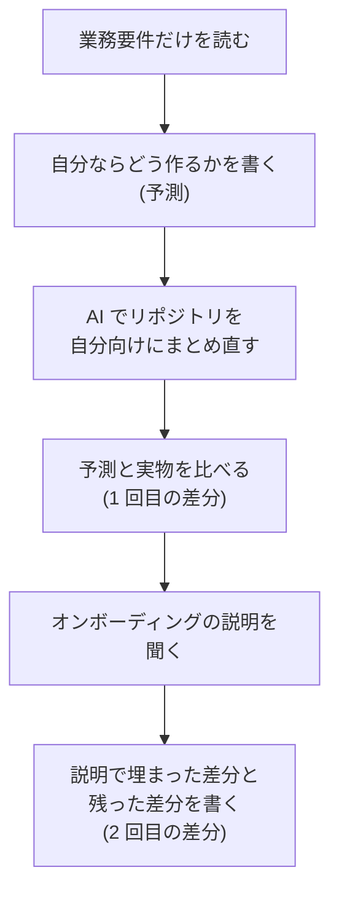

今回は、AI を使えるようになった今、オンボーディングをどう進めるかというお話です。

新しいチームに入ると、最初の数日でシステムの説明を受けます。構成図・業務の流れ・テーブルの一覧を順に聞き、その場では「ほえー」と頷けます。

ところが、終わったあとに「どこまで分かったか」と聞かれると答えられません。分かった気になっているだけなのか、本当に分かったのか、自分でも区別がつきません。従来のオンボーディングは、このふわふわした状態で終わりがちでした。

そこでこの記事では、オンボーディングを「情報を受け取る場」から「自分の予測と実物の差分を確かめる場」に置き換える進め方を書きます。全体の流れは以下の通りです：

説明を聞く前に予測と 1 回目の差分の確認を済ませておき、説明の時間を 2 回目の差分の確認に使います。前半の 2 節で学習の仕組みと研究を、後半の 3 節で手順を書きます。

## 人は読みながら予測している

人は資料を読んでいる間も、頭の中で先を予測しています。読み進めるうちにメンタルモデルができ、次はこうなるだろうと予測し、実物との差分で学んでいます。脳を、予測と実際の誤差を減らすように働く仕組みとして説明する理論もあります(Clark, 2013)。

問題は、読みながらの予測が頭の中だけにあって、外れても気づきにくいことです。Brod たちの 2018 年の実験では、予測が外れたときに驚きの反応(瞳孔の拡大)が出たのは、先に予測を答えていた場合だけでした。拡大が大きいほど、あとで正しく覚え直せていました。

予測を言葉にしていないと、外れても驚きが起きず、差分として残りません。説明を聞いて「ほえー」で終わるのは、この状態だと考えています。すらすら読めることと理解の違いは [予測差分から導く真の理解](/blog/fluency-vs-diff/) に書きました。

## 先に予測すると記憶に残る

教わる前にまず自分で予測したり解いたりすると記憶に残ることは、文章を読む場面と問題を解く場面の両方で確かめられています。

たとえば、Richland たちの 2009 年の実験では、2 ページの科学エッセイを読ませています。一方の群は先に 2 分のプレテストを受けてから 8 分読み、もう一方の群は 10 分読みました。プレテストの答えは 95% が外れていましたが、プレテストで聞かれた項目の最終テストの正答率は 75% で、10 分読んだ群の 56% を上回りました。ただし、プレテストで聞かれなかった項目は 50% で、効果は聞かれた項目にしか出ていませんでした。

教わる前に自分で問題を解く効果は、Productive Failure という名前で研究されています。Sinha と Kapur の 2021 年のメタ分析では、53 の研究で「先に解いてから教わる」と「教わってから解く」を比べ、先に解く方が成績がよいと報告されています(効果量 g = 0.36)。ただし、小学 2〜5 年生や特定の領域によらない一般的なスキルでは、教わってから解く方が成績がよくなっていました。

どちらの研究も、システムのオンボーディングを題材にしたものではありません。それでも私は、予測を先に書いて外れた箇所に注意を向ける仕組みは、オンボーディングにも当てはまると考えています。システムの場合に予測にあたるのは、「自分ならどう設計するか」を書き出すことです。

## 業務要件から自分で設計してみる

最初に機能を 1 つ選び、コードを開かずにその業務要件だけを読んで、自分ならどう作るかを書きます。数十行で十分で、外れていてかまいません。要件のドキュメントがなければ、画面の動きから要件を書き出します。

たとえば、EC サイトの返品機能で考えます。業務要件は「購入から 30 日以内なら返品でき、返金は購入時のカードに戻す」だとします。予測として書いたものは以下の通りです：

- 注文テーブルに返品状態の列を足す
- 返品を受け付けたら、その場で決済サービスの返金 API を呼ぶ
- 30 日の判定は注文日時から計算する

## AI でまとめ直して実物と比べる

予測を書いたら、AI でリポジトリとドキュメントの中身を自分がインプットしやすい形式にまとめ直します。元の情報はリポジトリとドキュメントにあり、AI は見せ方を変えるだけです。たとえば、以下のようなものです：

- 解説動画
- 散歩中に聞くポッドキャスト
- 概念と関係を 1 枚にしたオントロジーマップ

どの形式が分かりやすいかは人によって違うので、自分に合うものを選べます。オントロジーマップの使いどころは [オントロジーマップの評価](/blog/ontology-map-evaluation/) に書きました。まとめ直したものを予測なしで眺めると、説明を聞いて「ほえー」となったときと同じ状態になるので、開くのは予測を書いたあとにします。

返品の例なら、AI でまとめ直した返品機能の解説と実際のコードで実物を確かめます。仮に予測と実物が次のようになっていたとします。

| | 予測 | 実物 |
| --- | --- | --- |
| 返品の持ち方 | 注文テーブルに返品状態の列を足す | 注文とは別のテーブル。1 つの注文に複数の返品がぶら下がる |
| 返金のタイミング | 受付時にその場で返金 API を呼ぶ | 倉庫で商品の到着を確認したあと、夜間のバッチで呼ぶ |
| 30 日の起点 | 注文日時 | 配達完了日時 |

予測の 3 行はどれも外れています。外れた 3 行の実物の側に、要件だけでは見えないこのシステムの判断が表れています。

当たった行は深追いせず、外れた行だけを手元に残します。予測を書かずに実物を読むと、「返品は別テーブルなんだな」と知るだけで終わります。予測を書いてから読むと、「注文に持たせると思っていたのに別テーブルだった。なぜか」と考えるようになります。

この段階で書くのは「なぜか」という問いまでです。なぜこう作ったかは、コードを読んでも分からないことが多いからです。

## 説明の時間は差分の確認に使う

1 回目の差分の確認を済ませてから説明を受けると、説明の時間の使い方が変わります。

| | 従来 | 差分を持って臨む |
| --- | --- | --- |
| 説明の前に手元にあるもの | 何もない | 予測と、外れた行の一覧 |
| 説明中にすること | 全部を聞いて覚えようとする | 外れた行の理由を確かめる |
| 出る質問 | 「〜って何ですか」 | 「〜だと思っていたが違った。なぜですか」 |
| 終わったあとに残るもの | 「ほえー」という感覚 | 埋まった差分と、まだ残っている差分 |

外れた行の一覧を事前に渡しておけば、話し手は全部を最初から説明せずに済みます。コードからは読み取れない「なぜそう作ったか」の話に時間を使えるので、説明の価値が上がります。

返品の例なら、説明で次のような理由が分かるはずです：

- 1 つの注文のうち一部の商品だけが返品されることがあるので、返品を別のテーブルにしている
- 商品が戻る前に返金すると損をするので、到着を確認してから返金している
- 配達が遅れた人が不利にならないように、30 日を配達完了から数えている

説明のあとに、新しく気づいた点も加えて、差分を以下の 3 つに整理して書きます：

- 説明で理由が分かった行
- 説明でも分からなかった行
- 説明を聞いて新しく気づいた外れの行

理由を自分の言葉で 1 文書けた行だけを「説明で理由が分かった行」に入れます。こうすると、分かった気になっているだけの箇所を行単位で見分けやすくなります。この 2 回目の差分が、オンボーディングで何を理解し、何がまだ分かっていないかの記録になります。

## さいごに

人の学びの中心には、もともと予測と実物の差分があります。これまでは、資料を読みながら頭の中で予測が立ち上がるだけで、外れても気づかずに通り過ぎることが多かったのだと思います。

AI がリポジトリやドキュメントを自分向けにまとめ直してくれるようになった分、人は予測を書き出して差分を確かめる部分に時間を使えます。この記事ではオンボーディングで考えましたが、予測を書いて比べる部分は、新しいことを学ぶ場面の多くで同じ形を取れると思っています。たとえば、以下のような場面です：

- 新しいライブラリなら、使い方を読む前に API を予想し、AI でまとめ直した解説と公式ドキュメントで確かめる
- 新しい業務領域なら、用語集を読む前に業務の流れを書いてみて、AI でまとめ直した概念マップと比べる
- 論文なら、本文を読む前に手法を予想し、AI でまとめ直した要約と本文で確かめる

## 出典

- Clark (2013) Whatever next? Predictive brains, situated agents, and the future of cognitive science. Behavioral and Brain Sciences 36(3). https://pubmed.ncbi.nlm.nih.gov/23663408/
- Brod, Hasselhorn & Bunge (2018) When generating a prediction boosts learning: The element of surprise. Learning and Instruction 55. https://idw-online.de/en/news693157 (解説記事)
- Brod (2021) Predicting as a learning strategy. Psychonomic Bulletin & Review 28. https://pmc.ncbi.nlm.nih.gov/articles/PMC8642250/
- Richland, Kornell & Kao (2009) The pretesting effect: Do unsuccessful retrieval attempts enhance learning? Journal of Experimental Psychology: Applied 15(3). https://learninglab.uchicago.edu/Pre-Testing_files/RichlandKornellKao.pdf (75% / 56% / 50% は実験 1)
- Sinha & Kapur (2021) When problem solving followed by instruction works: Evidence for productive failure. Review of Educational Research 91(5). https://doi.org/10.3102/00346543211019105
