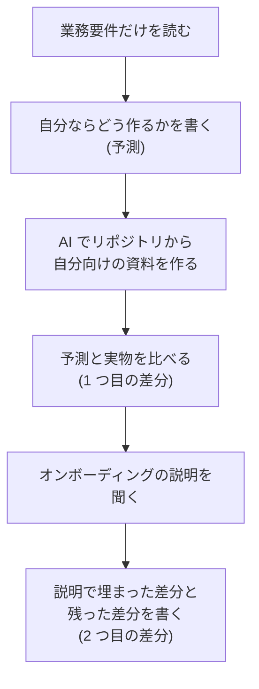

新しいチームに入ると、最初の数日でシステムの説明を受けます。全体の構成図、主要な業務の流れ、テーブルの一覧。聞いている間は「ほえー」と頷けますが、終わったあとに「どこまで分かったのか」と聞かれると答えられません。分かった気になっているのか、本当に分かったのか、自分でも区別がつかない。従来のオンボーディングは、このふわふわした状態で終わりがちでした。

この記事では、オンボーディングを「情報を受け取る場」から「自分の予測と実物の差分を確かめる場」に置き換える手順を書きます。先に全体の流れを示します。

図は、説明を聞く前に予測と 1 回目の比較を済ませておき、説明の時間を 2 回目の比較に使う流れを示しています。

## 資料は自分で作れるようになった

リポジトリとドキュメントへのアクセス権をもらった時点で、そのシステムについての資料は自分で作れます。AI にコードとドキュメントを読ませれば、解説動画、散歩中に聞くポッドキャスト、概念と関係を 1 枚にしたオントロジーマップが、数分から数十分で手に入ります。どの形式が分かりやすいかは人によって違うので、自分に合う形式を選べます。オントロジーマップの使いどころは [オントロジーマップの評価](/blog/ontology-map-evaluation/) に書きました。

ただ、資料が分かりやすくなるほど、眺めただけで「わかった」と感じやすくなります。読みやすさは理解の信号ではなく、処理が軽かったという信号です。この点は [予測差分から導く真の理解](/blog/fluency-vs-diff/) に詳しく書きました。自分向けの資料を作れても、眺めて終わるなら、従来の説明を聞いて「ほえー」となるのと同じ状態が残ります。

## 先に予測を書くと残る

学ぶ前にテストを受けると、外れても、その後の学習がよく残ります。これを事前テスト効果と呼びます。Kornell たちの 2009 年の実験では、単語の対を覚える課題で、先に相手の単語を当てずっぽうで答えてから対を見た群の正答率が 67%、同じ時間ずっと対を見ていた群が 55% でした。予測は 8〜9 割外れていましたが、それでも差が出ています。

この実験の題材は単語の対で、システムの理解ではありません。それでも、予測を置くと「実際 − 予測」の差分が出て、その差分の分だけ頭の中のモデルが更新されるという仕組みは、オンボーディングにもそのまま当てはまると私は考えています。システムの場合、予測にあたるのは「自分ならこう設計する」です。

## 業務要件から自分で設計してみる

最初にやるのは、コードを開かずに業務要件だけを読み、自分ならどう作るかを書くことです。数十行で十分で、外れていてかまいません。

例として、EC サイトの返品機能で考えます。業務要件は「購入から 30 日以内なら返品でき、返金は購入時のカードに戻す」だとします。

予測として書いたもの:

- 注文テーブルに返品状態の列を足す
- 返品を受け付けたら、その場で決済サービスの返金 API を呼ぶ
- 30 日の判定は注文日時から計算する

次に、AI に作らせた資料と実際のコードで、実物を確かめます。仮に実物が次のようになっていたとします。

- 返品は注文とは別のテーブルで、1 つの注文に複数の返品がぶら下がる
- 返金は受付時ではなく、倉庫で商品の到着を確認したあとに夜間のバッチで呼ぶ
- 30 日の判定は注文日時ではなく配達完了日時から数える

3 行とも外れています。この外れた 3 行が、要件だけでは見えないこのシステムの判断です。一部だけ返品される注文がある、商品が戻る前に返金すると損をする、配達が遅れた人が不利にならないようにしている、といった業務の事情が、差分の裏にあります。当たった行は流し、外れた行だけを残します。

予測を書かずに実物を読むと、「返品は別テーブルなんだな」と読めて終わります。予測を書いてから読むと、「自分は注文に持たせると思っていたが、別テーブルだった。なぜか」と問いが立ちます。

## オンボーディングの説明を差分の確認に置き換える

予測と 1 回目の比較を済ませてから説明を受けると、説明の時間の使い方が変わります。

| | 従来 | 差分を持って臨む |
| --- | --- | --- |
| 説明の前に手元にあるもの | 何もない | 予測と、外れた行の一覧 |
| 説明中にすること | 全部を聞いて覚えようとする | 外れた行の理由を確かめる |
| 出る質問 | 「〜って何ですか」 | 「〜だと思っていたが違った。なぜですか」 |
| 終わったあとに残るもの | 「ほえー」という感覚 | 埋まった差分と、まだ残っている差分 |

説明する側から見ても、聞き手がどこでつまずいているかが分かります。全部を最初から話す必要がなくなり、外れた行の理由に時間を使えます。コードを読んでも分からない「なぜこう作ったか」は、説明する人の頭の中にしかないことが多いので、そこに時間を使えると説明の価値が上がります。

説明のあとに、もう一度差分を書きます。説明で理由が分かった行、説明でも分からなかった行、説明を聞いて新しく気づいた外れ。この 2 回目の差分が、オンボーディングで何を理解し、何がまだ分かっていないかの記録になります。「分かった気になっているか分からない」という状態を、行単位で区別できるようになります。

## オンボーディング以外の学びにも使える

この手順はシステムのオンボーディングで考えましたが、新しいことを学ぶ場面の多くで同じ形が取れると思っています。新しいライブラリなら使い方を読む前に API を予想する、新しい業務領域なら用語集を読む前に業務の流れを書いてみる、論文なら本文を読む前に手法を予想する。

AI によって、自分向けの分かりやすい資料を作るコストはほぼなくなりました。その分、学ぶ人がやることは「資料を読む」から「予測を書いて、AI が作った資料と実物で差分を確かめる」に移っていくのではないかと考えています。資料づくりを AI に任せ、人は予測と差分の確認に時間を使う。この分担が、AI を使った学び方の 1 つの型になりそうです。

## 出典

- Kornell, Hays & Bjork (2009) Unsuccessful retrieval attempts enhance subsequent learning. Journal of Experimental Psychology: Learning, Memory, and Cognition 35(4). http://web.williams.edu/Psychology/Faculty/Kornell/Publications/Kornell.Hays.Bjork.2009.pdf (67% / 55% は実験 4)
