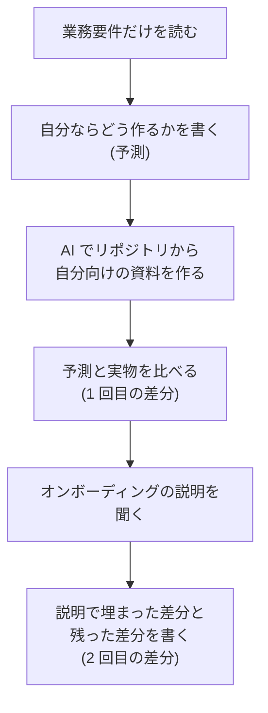

今回は、AI を使える今のオンボーディングをどう進めるかというお話です。

新しいチームに入ると、最初の数日でシステムの説明を受けます。構成図・業務の流れ・テーブルの一覧を順に聞き、その場では「ほえー」と頷けます。

ところが、終わったあとに「どこまで分かったか」と聞かれると答えられません。分かった気になっているだけなのか、本当に分かったのか、自分でも区別がつきません。従来のオンボーディングは、このふわふわした状態で終わりがちでした。

そこでこの記事では、オンボーディングを「情報を受け取る場」から「自分の予測と実物の差分を確かめる場」に置き換える進め方を書きます。全体の流れは以下の通りです：

説明を聞く前に予測と 1 回目の差分を済ませておき、説明の時間を 2 回目の差分に使います。前半の 2 節で予測を先に置く理由を、後半の 2 節で手順を書きます。

## AI で資料が作れるようになって起きること

リポジトリとドキュメントへのアクセス権をもらった時点で、そのシステムの資料は自分で作れます。AI にコードとドキュメントを読ませれば、数分から数十分で以下のような資料が手に入ります：

- 解説動画
- 散歩中に聞くポッドキャスト
- 概念と関係を 1 枚にしたオントロジーマップ

どの形式が分かりやすいかは人によって違うので、自分に合う形式を選べます。オントロジーマップの使いどころは [オントロジーマップの評価](/blog/ontology-map-evaluation/) に書きました。

ただし、資料が分かりやすくなるほど、眺めただけで「わかった」と感じやすくなります。読みやすく感じるのは処理が軽かったからで、理解できたからとは限りません。この点は [予測差分から導く真の理解](/blog/fluency-vs-diff/) に書きました。

自分向けの資料を作れても、眺めて終わるなら「ほえー」となったときと同じ状態が残ります。そのため、資料を開くのは予測を書いたあとにします。

## 事前テスト効果

学ぶ前にテストを受けると、答えが外れても、その後の学習がよく残ります。これを事前テスト効果と呼びます。

たとえば、Kornell たちの 2009 年の実験では、単語の対を覚える課題で、先に相手の単語を当てずっぽうで答えてから対を見た群の正答率が 67% でした。1 回あたりの時間を揃えて、ずっと対を見ていた群は 55% です。予測は 8〜9 割外れていましたが、それでも差が出ています。条件と数値の詳細は [予測差分から導く真の理解](/blog/fluency-vs-diff/) に表で載せています。

この実験の題材は単語の対で、システムの理解ではありません。それでも私は、予測を置くと「実際 − 予測」の差分が出て、その差分の分だけ頭の中のモデルが更新されると考えています。この仕組みはオンボーディングにも当てはまり、システムの場合に予測にあたるのは「自分ならこう設計する」です。

## 業務要件から自分で設計してみる

最初に機能を 1 つ選び、コードを開かずにその業務要件だけを読んで、自分ならどう作るかを書きます。数十行で十分で、外れていてかまいません。要件のドキュメントがなければ、画面の動きから要件を書き出します。

たとえば、EC サイトの返品機能で考えます。業務要件は「購入から 30 日以内なら返品でき、返金は購入時のカードに戻す」だとします。

予測を書いたら、AI に作らせた返品機能の解説と実際のコードで実物を確かめます。仮に予測と実物が次のようになっていたとします。

| | 予測 | 実物 |
| --- | --- | --- |
| 返品の持ち方 | 注文テーブルに返品状態の列を足す | 注文とは別のテーブル。1 つの注文に複数の返品がぶら下がる |
| 返金のタイミング | 受付時にその場で返金 API を呼ぶ | 倉庫で商品の到着を確認したあと、夜間のバッチで呼ぶ |
| 30 日の起点 | 注文日時 | 配達完了日時 |

予測の 3 行はどれも外れています。この外れた 3 行が、要件だけでは見えないこのシステムの判断です。

当たった行はそのままにして、外れた行だけを残します。予測を書かずに実物を読むと、「返品は別テーブルなんだな」と読めて終わります。予測を書いてから読むと、「注文に持たせると思っていたのに別テーブルだった。なぜか」と考えるようになります。

この段階で書くのは「なぜか」という問いまでです。なぜこう作ったかは、コードを読んでも分からないことが多いからです。

## 説明の時間は差分の確認に使う

1 回目の差分を済ませてから説明を受けると、説明の時間の使い方が変わります。

| | 従来 | 差分を持って臨む |
| --- | --- | --- |
| 説明の前に手元にあるもの | 何もない | 予測と、外れた行の一覧 |
| 説明中にすること | 全部を聞いて覚えようとする | 外れた行の理由を確かめる |
| 出る質問 | 「〜って何ですか」 | 「〜だと思っていたが違った。なぜですか」 |
| 終わったあとに残るもの | 「ほえー」という感覚 | 埋まった差分と、まだ残っている差分 |

外れた行の一覧を説明の前に渡しておけば、説明する側は全部を最初から話さずに、その行の理由に時間を使えます。なぜこう作ったかは説明する人しか知らないことが多いので、説明する人がそこに時間を使えると説明の価値が上がります。

返品の例なら、説明で次のような理由が分かるはずです：

- 1 つの注文のうち一部の商品だけが返品されることがあるので、返品を別のテーブルにしている
- 商品が戻る前に返金すると損をするので、到着を確認してから返金している
- 配達が遅れた人が不利にならないように、30 日を配達完了から数えている

説明のあとに、もう一度差分を以下の 3 つに分けて書きます：

- 説明で理由が分かった行
- 説明でも分からなかった行
- 説明を聞いて新しく気づいた外れ

理由を自分の言葉で 1 行書けた行だけを「分かった」に入れます。こうすると、分かった気になっているだけの行を行単位で見分けやすくなります。この 2 回目の差分が、オンボーディングで何を理解し、何がまだ分かっていないかの記録になります。

## さいごに

冒頭の図の進め方はシステムのオンボーディングで考えましたが、予測を書いて比べる部分は、新しいことを学ぶ場面の多くで同じ形を取れると思っています。たとえば、以下のような場面です：

- 新しいライブラリなら、使い方を読む前に API を予想し、AI に作らせた解説と公式ドキュメントで確かめる
- 新しい業務領域なら、用語集を読む前に業務の流れを書いてみて、AI に作らせた概念マップと比べる
- 論文なら、本文を読む前に手法を予想し、AI に作らせた要約と本文で確かめる

AI のおかげで、自分向けの分かりやすい資料を作るコストはかなり下がりました。資料づくりを AI に任せられるようになった分、学ぶ人は予測を書いて差分を確かめることに時間を使えるようになると考えています。

## 出典

- Kornell, Hays & Bjork (2009) Unsuccessful retrieval attempts enhance subsequent learning. Journal of Experimental Psychology: Learning, Memory, and Cognition 35(4). http://web.williams.edu/Psychology/Faculty/Kornell/Publications/Kornell.Hays.Bjork.2009.pdf (67% / 55% は実験 4)
