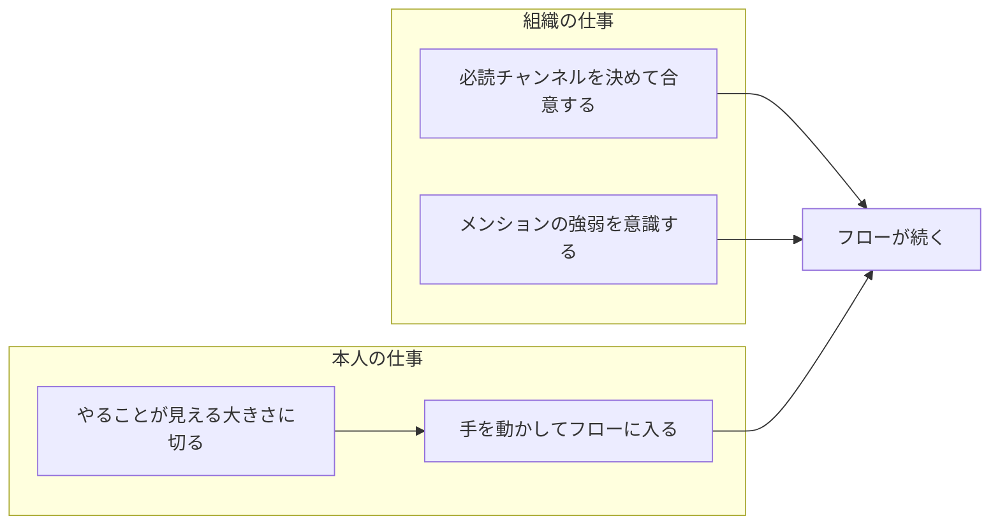
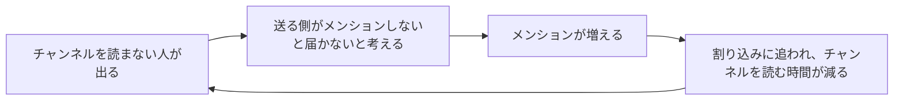

仕事で最も大切にしたいのはフロー状態だと思っています。フローに入っていると、次に何をするかを考えなくても手が動き、1 時間で進む量が普段とは変わります。この記事では、フローに入るために本人がすることと、入ったフローを守るために組織がすることを分けて書きます。

図は、フローに入るまでを本人が整え、入った後に続くかどうかは周りの振る舞いで決まるという分担を示しています。

## フローに入るのは本人の仕事

フローに入りやすいのは、やることがもう見えている作業です。何をするかが決まっていれば、とりあえず手を動かし始められ、動かしているうちに集中が深まっていきます。

フロー研究の Csikszentmihalyi は、フローに入る条件として「目標がはっきりしている」「結果がすぐ返ってくる」「課題の難しさと自分の力が釣り合っている」を挙げています。やることが見える大きさに作業を切ると、前の 2 つが揃います。何を終わらせるかが決まり、手を動かすたびに進んだかどうかが分かるからです。

作業をこの大きさに切るのは、本人の仕事です。

## 中断で増えるのは時間より負担

フローに入るまでには時間がかかりますが、抜けるのは Slack の通知 1 つで済みます。中断のコストというと戻るまでの時間がよく話題になりますが、私が強く感じているのは負担感の方です。

Mark らは 2008 年の実験で、作業の途中で中断される群と中断されない群を比べました。中断された群は作業を短い時間で終え、出来にも差はありませんでした。その代わりに、ストレス・苛立ち・時間に追われる感覚・労力の評価が高くなっていました。中断された人は速く働いて埋め合わせ、その分ストレスと労力の評価が上がっていました。

認知負荷理論（Sweller ほか）では、課題そのものの難しさから来る負荷を内在的負荷、課題と関係のない処理から来る負荷を外在的負荷と呼びます。割り込みに応じることや、元の作業を思い出し直すことは外在的負荷です。

AI を使うようになって、1 日の労働負荷は増えました。内在的負荷だけでもう十分に重いので、外在的負荷はできるだけ減らしたいと考えています。そのための仕組みを、自分と組織の両方で作ります。

## 自分のフローを守る

自分でできることは 2 つです。

- 集中する時間は通知を切る
- チャンネルは、休憩や作業の切れ目に自分から読みに行く

非同期コミュニケーションの利点は、受け手が読む時間を選べることです。相手の都合で割り込まれるのではなく、自分の都合で取りに行けます。

ただ、私はチャンネルをほぼ全部読んでいて、それで自分の集中を削っている気もしています。チャンネルを読んでいるだけで仕事をした気になりますが、成果につながっていなければ仕事ではありません。読むかどうかも、行動として選ぶ必要があります。

## 他人のフローを守る

他人のフローを切らないために、私はメンションを付けるたびに、その用件にメンションが必要かを考えています。人を指名して依頼するときは、どうしてもメンションになります。それ以外は、用件の急ぎ具合で付けるかどうかを決めます。

| メンション | 受け手が読むタイミング | 使う場面 |
| --- | --- | --- |
| 付ける | 送った時点で割り込む | 今すぐ動いてほしい、人を指名して依頼する |
| 付けない | 受け手が切れ目に読む | 読んでおいてほしい、共有したい |

読んでほしい程度の用件は、関係するチャンネルにメンションなしで流します。そのチャンネルを読む人なら、切れ目に読むはずだからです。

自分の仕事を早く終わらせたいときほど、全部にメンションを付けたくなります。けれど組織全体で見ると、今すぐ必要なものと後でよいものの強弱があります。メンションは相手の作業をその場で中断させます。相手のフローを切るのは重い行為なので、なんでもメンションにするのではなく、その強弱を意識してほしいと思っています。

## 必読チャンネルを決めて合意する

メンションなしで流す運用は、受け手がそのチャンネルを読んでいる前提で成り立っています。チャンネルを読まない人が出ると、次の循環が始まります。

図が示しているのは、メンションが増えるほどチャンネルが読まれなくなり、読まれなくなるほどメンションが増える循環です。私はこれをメンション地獄と呼んでいます。

この循環は簡単にできてしまいます。必読のチャンネルなのに読まない人が許されていると、チャンネルを読んで動いている人ほど損をする構造になります。読まない人に届けるためのメンションは、読んでいる人にも届きます。読んでいる人は、今すぐ対応しなくてよい用件に目を向けさせられ、フローを切られます。全員が集まるミーティングで、必読の投稿を共有する時間が取られることもあります。読んでいる人にとっては、すでに読んだ内容をもう一度聞くだけの時間です。ルールを守っている人が報われない構造は良くありません。そして送る側は、必読の投稿を読んでほしいがためにメンションを付けるようになり、メンションは増え続けます。

Perlow は 1999 年に、あるソフトウェア開発チームを 9 か月観察しました。メンバーは互いに割り込み合い、各自の作業を進めにくい状態でした。その状態が続いた背景には、危機対応を前提にした働き方と、個人の奮闘を評価する仕組みがありました。割り込まない時間帯を決めるなど、メンバーの時間の使い方を変えると、チームとしての生産性が上がりました。

この循環を止めるには、個人の心がけより先に組織で合意を取ります。

- 必ず読むチャンネルを絞って決める
  - 全部を読めとは言いません。全体に関わる大事な投稿が流れるチャンネルだけを決めます
- そこに出た投稿は、全員が読んでいる前提で動く
- 中央の投稿を、各チームのチャンネルに流し直さない
  - 流し直すと、中央を読まなくても済む状態を組織が認めたことになります
必読チャンネルが決まれば、そこに書いた内容は全員が知っている前提で仕事を進められます。届けるためだけのメンションも要らなくなります。

## まとめ

- フローに入るのは本人の仕事。やることが見える大きさに作業を切ってから手を動かす
- 中断で増えるのは時間より負担。外在的負荷を減らし、内在的負荷に集中できる仕組みを作る
- フローを守るのは組織の仕事。必読チャンネルを決めて合意し、メンションを付けるたびにその必要性と強弱を意識する

## 出典

- Csikszentmihalyi (1990) Flow: The Psychology of Optimal Experience. Harper & Row.
- Sweller, van Merriënboer & Paas (1998) Cognitive architecture and instructional design. Educational Psychology Review 10(3).
- Mark, Gudith & Klocke (2008) The cost of interrupted work: more speed and stress. CHI 2008. https://ics.uci.edu/~gmark/chi08-mark.pdf
- Perlow (1999) The time famine: Toward a sociology of work time. Administrative Science Quarterly 44(1). https://doi.org/10.2307/2667031
