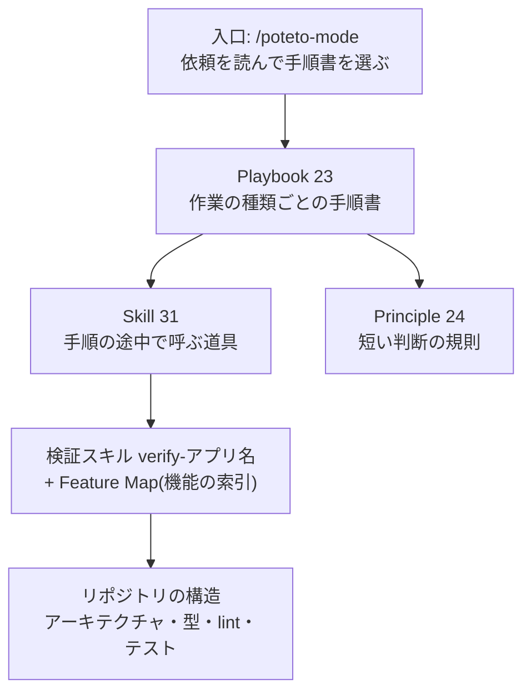

pstack は、Cursor のプラグインとして公開されているスキルの集まりです。作者は poteto(Lauren Tan)さんで、README の時点では Cursor に所属していました。この記事は、2026-10-18 時点の pstack 0.15.26(cursor/plugins のコミット 0b8e952)と、poteto さんの記事・投稿だけを出典にして、仕組みと考え方を読みます。

pstack が解こうとしている問題は 1 つです。エージェントが「直しました。テストも通っています」と報告しても、それはエージェントがそう判断したという情報でしかありません。人間が差分を読み、アプリを動かして確かめる限り、エージェントを何体並べても、確かめられる数は人間 1 人分で止まります。README には「質を伴わない処理量は目標ではない」とあります。

## 全体像

上の 4 つ(入口・手順書・道具・規則)は pstack が持つ部品で、下の 2 つはプロジェクトの側に置くものです。pstack は、下の 2 つをプロジェクトに作らせ、保たせる道具も含んでいます。

## 読みどころ

1. 依頼には「何をもって完了か」を書き、やり方は書かない
   - 依頼に書くのは、目的・完了の判定・見たい証拠・分かっていること・本当の制約の 5 つまでです
   - やり方とスキルの並びは書きません。手順書が順番を持っているので、手で並べると手順が抜けたり入れ替わったりします
   - 選ばれた手順書は、要約せずに Todo リストの先頭へそのまま写されます。飛ばす手順も消さず、skip と理由を書いて残します
2. 出荷する行は、すべて実行時の証拠にたどれること
   - Bug fix の手順書の冒頭にある方針です。「役に立つかもしれない予防策」は仮説であって、修正ではありません
   - 再現は報告と同じ画面や CLI で、エージェント自身が行います。確認も同じ面で行い、単体テストの合格は「不具合がない」証拠として扱いません
   - 失敗する再現を修正より先にコミットします。履歴に、壊れていた証拠と直った証拠が順に並びます
3. 主張には、証拠か「測定・推論・推測」のラベルを同じ文に付ける
   - Prove It Works という原則は、代わりの指標・自己申告・「コンパイルが通った」で済ませることを認めません
   - ガイドは、証拠のない自信のある返答を警告のサインとしています
4. 確かめる手段はプロジェクトの側に置く
   - /create-verification-skill はリポジトリを読んで、起動・状態の点検・操作・証拠・後片付けの節を持つ検証スキルを作ります。人に聞くのは、コードから分からないことだけです
   - 機能の索引(Feature Map)には、機能ごとのたどり着き方と操作のしかたを書きます
   - アプリが変わると索引が古くなるので、/maintain-verification-skill を少なくとも 1 日 1 回回します
5. 記憶はコードベースに置く
   - poteto さんは解説記事の第 1 回で「コードベースこそが究極の記憶だ」と書いています
   - 2026-10-16 の投稿では、エージェントの仕事を信頼する手段を「コードの改善 → 静的解析 → 文章 → 人のレビュー」の順に並べ、上ほど力を入れるよう勧めています。エージェントは既にあるものを写し、一番短い道を取るので、正しいやり方を一番簡単なやり方にしておけば、その間違いは起きなくなります
   - /correct は 2 回起きた間違いを集め、直せる一番上の段で直します。新しいチェックが、過去に実際に起きた間違いで失敗することまで確かめます
6. CI が緑でも、出してよいとは限らない
   - poteto-mode の規則に "Green is not safe" とあります
   - 出荷の手順書では、PR ごとに、書いていない別のエージェントが利用者と同じ操作で変更を動かして判定します。CI の緑もボットの承認も、変更を動かしていないので判定に数えません
   - 下から連続して判定が通った範囲だけを、1 本ずつマージします

## 0.15.9 から 0.15.26 で増えたもの

2026-10-03 の 0.15.9 から 10-18 の 0.15.26 までに、pstack のフォルダには 45 本のコミットが入り、スキルが 5 つ増えました。

- /poteto-help: 質問に答え、送るためのプロンプトを渡す。作業は始めない
- /in-your-own-words と /sharpen: 作業の前に、目的と問題を言い直させる
- /ketchup: 前回の発言からの変化と、利用者が決めることを全部並べる
- /create-formal-verification-skill(10-17): テストでは届かない競合や状態の遷移を、TLA+ などの形式検証で確かめるスキルを作る
- Claude Code にもプラグインとして入れられるようになった

## 解説動画

ここまでの内容を、ずんだもんと四国めたんの掛け合いの動画(11 分)にもしています。Bug fix の手順書と検証スキルの例は、動画の方が具体的です。

<figure class="video-embed">
<iframe src="/videos/pstack.html" title="pstack の入口と検証(解説動画 11:28)" scrolling="no" loading="lazy"></iframe>
<figcaption><a href="/videos/pstack.html" target="_blank" rel="noopener">動画だけを別タブで開く</a>(台本と出典つき)</figcaption>
</figure>

作る前に人に聞く grill と、作ってから見せる pstack の使い分けは、[先に決めるか、作ってから決めるか(grill/pstack)](/blog/decide-before-or-after/) に書きました。

## 出典

- https://github.com/cursor/plugins/tree/0b8e952052d482ee6de06deebf14d590d77b1b34/pstack (pstack 0.15.26)
- https://github.com/cursor/plugins/blob/0b8e952052d482ee6de06deebf14d590d77b1b34/pstack/README.md
- https://github.com/cursor/plugins/blob/0b8e952052d482ee6de06deebf14d590d77b1b34/pstack/skills/poteto-mode/SKILL.md
- https://github.com/cursor/plugins/blob/0b8e952052d482ee6de06deebf14d590d77b1b34/pstack/skills/poteto-mode/playbooks/bug-fix.md
- https://github.com/cursor/plugins/blob/0b8e952052d482ee6de06deebf14d590d77b1b34/pstack/skills/poteto-mode/playbooks/shipping.md
- https://github.com/cursor/plugins/blob/0b8e952052d482ee6de06deebf14d590d77b1b34/pstack/skills/principle-prove-it-works/SKILL.md
- https://github.com/cursor/plugins/blob/0b8e952052d482ee6de06deebf14d590d77b1b34/pstack/skills/principle-never-block-on-the-human/SKILL.md
- https://github.com/cursor/plugins/blob/0b8e952052d482ee6de06deebf14d590d77b1b34/pstack/skills/correct/SKILL.md
- https://github.com/cursor/plugins/blob/0b8e952052d482ee6de06deebf14d590d77b1b34/pstack/skills/create-verification-skill/SKILL.md
- https://github.com/cursor/plugins/blob/0b8e952052d482ee6de06deebf14d590d77b1b34/pstack/skills/create-formal-verification-skill/SKILL.md
- https://github.com/cursor/plugins/blob/0b8e952052d482ee6de06deebf14d590d77b1b34/pstack/skills/poteto-help/SKILL.md
- https://github.com/cursor/plugins/blob/0b8e952052d482ee6de06deebf14d590d77b1b34/pstack/skills/in-your-own-words/SKILL.md
- https://github.com/cursor/plugins/blob/0b8e952052d482ee6de06deebf14d590d77b1b34/pstack/skills/sharpen/SKILL.md
- https://github.com/cursor/plugins/blob/0b8e952052d482ee6de06deebf14d590d77b1b34/pstack/skills/ketchup/SKILL.md
- https://github.com/cursor/plugins/blob/0b8e952052d482ee6de06deebf14d590d77b1b34/pstack/docs/guide/README.md
- https://github.com/cursor/plugins/blob/0b8e952052d482ee6de06deebf14d590d77b1b34/pstack/docs/guide/02-poteto-mode.md
- https://github.com/cursor/plugins/blob/0b8e952052d482ee6de06deebf14d590d77b1b34/pstack/docs/guide/06-verify-and-ship.md
- https://github.com/cursor/plugins/blob/0b8e952052d482ee6de06deebf14d590d77b1b34/pstack/docs/guide/07-overnight.md
- https://github.com/cursor/plugins/blob/0b8e952052d482ee6de06deebf14d590d77b1b34/pstack/docs/guide/09-make-it-yours.md
- https://github.com/cursor/plugins/blob/0b8e952052d482ee6de06deebf14d590d77b1b34/pstack/docs/harness/claude-code.md
- https://github.com/cursor/plugins/compare/e43c7ee26e0038c6c1fa8380dd34ce86ff94cb2a...0b8e952052d482ee6de06deebf14d590d77b1b34 (0.15.9 → 0.15.26)
- https://github.com/poteto/verification-skill-example/blob/d5abe70d0d8c671672b6cef4069363f26c488feb/.cursor/skills/verify-atlas/SKILL.md
- https://x.com/poteto/status/2094457600259842065 (The Complete Guide to pstack Pt. 1, 2026-08-31)
- https://x.com/poteto/status/2097732320606507506 (The Complete Guide to pstack Pt. 2, 2026-09-09)
- https://x.com/poteto/status/2102050467505430555 (2,500 PRs, 2026-09-21)
- https://x.com/poteto/status/2111133080526495985 (信頼の 4 段, 2026-10-16)
- https://x.com/kentcdodds/status/2106614158712254515
- https://x.com/poteto/status/2106818232787276178
- https://github.com/mattpocock/skills/blob/49dd158d1076134a641b33efb035946536778336/docs/productivity/grilling.md

音声は VOICEVOX:ずんだもん / VOICEVOX:四国めたん、イラストは VOICEVOX 公式(© SSS LLC)です。
