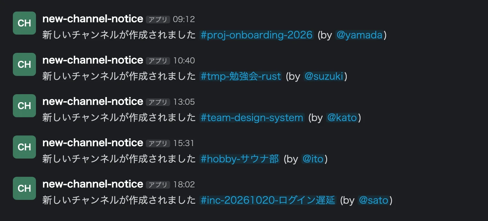
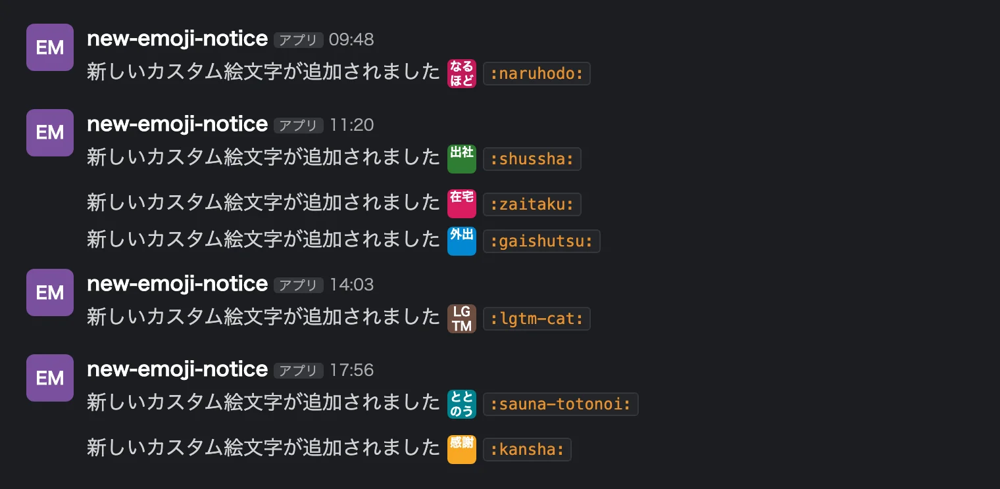
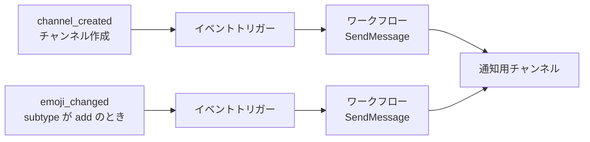

Slack ワークスペースには、「新しいチャンネルが作られた」と「新しいカスタム絵文字が追加された」の 2 つを専用チャンネルへ流す通知を、ほぼ必須で入れておくといいと考えています。この 2 つのメタデータが流れてくるだけで、ワークスペースの文化と、いま何が動いているかが分かるからです。

## 流れてくるもの

チャンネルの通知は、こういう投稿になります(名前はすべて架空です)。



チャンネル名を見ると、新しいプロジェクトが始まった、勉強会ができた、障害対応の部屋が立った、が分かります。興味があればその場で入ればいいし、なければ流せば済みます。どのチャンネルに入ればいいか分からない入社直後は、この一覧がそのまま入るチャンネルの候補になります。

絵文字の通知は、こういう投稿です。



カスタム絵文字は、そのワークスペースの文化を知るうえで大事な要素です。「出社」「在宅」「外出」の 3 点セットが追加されれば、勤務場所を絵文字で伝える習慣があると分かります。「なるほど」「感謝」のような反応用の絵文字が増えるのを見ていると、その職場でよく使われる言い回しも覚えられます。通知には絵文字の画像と `:name:` が並ぶので、気に入ったものはコードをコピーしてすぐ使えます。

## 仕組み

Slack CLI(Deno Slack SDK)で作るアプリで、Slack がホストする環境で動きます。自前のサーバーはいりません。



図が示しているのは、ワークスペースのイベント 2 種類をそれぞれイベントトリガーで受け、Slack 組み込みの SendMessage で通知用チャンネルに投稿するだけの構成だということです。通知先は 1 つのチャンネルにまとめても、チャンネル用と絵文字用に分けてもかまいません。

絵文字の側のトリガー定義は次のとおりです。`emoji_changed` は追加・削除・リネームのどれでも発火するので、`subtype` が `add` のものだけに絞ります。

```ts
const trigger: Trigger<typeof NotifyNewEmojiWorkflow.definition> = {
  type: TriggerTypes.Event,
  name: "New emoji added",
  workflow: `#/workflows/${NotifyNewEmojiWorkflow.definition.callback_id}`,
  event: {
    event_type: TriggerEventTypes.EmojiChanged,
    filter: {
      version: 1,
      root: { statement: "{{data.subtype}} == add" },
    },
  },
  inputs: {
    notify_to: { value: NOTIFY_NEW_EMOJI_TO },
    name: { value: TriggerContextData.Event.EmojiChanged.name },
  },
};
```

ワークフローのステップは SendMessage 1 つで、メッセージは `` 新しいカスタム絵文字が追加されました :${name}: `:${name}:` `` です。同じ名前を絵文字として 1 回、コードとして 1 回埋め込むと、画像とコピー用の文字列が並んだ投稿になります。

導入の手順は次の 3 つです。

1. 通知先チャンネルを作り、そのチャンネル ID を設定ファイルに書く
2. `slack deploy` でアプリをワークスペースに入れる
3. `slack trigger create` でトリガーを 2 つ登録する

## 作るときの注意

- ワークスペースが有料プランである必要があります。無料プランでは `slack deploy` が `free_team_not_allowed` で失敗します
- ステップが組み込みの SendMessage だけなら、Slack の「標準ワークフロー」扱いで実行回数の課金対象になりません。カスタム関数を足すとプレミアムワークフローになり、プランごとの実行回数の上限に掛かります
- Zapier のような外部サービスでも作れますが、無料枠だと絵文字をまとめて登録した日に月間のタスク上限を超えて通知が止まることがあります。Slack がホストするワークフローならこの上限を気にせずに済みます
- アプリはインストールした人のアカウントに紐づきます。その人がワークスペースを離れると管理できなくなるので、`slack collaborators add` で共同管理者を足しておきます
