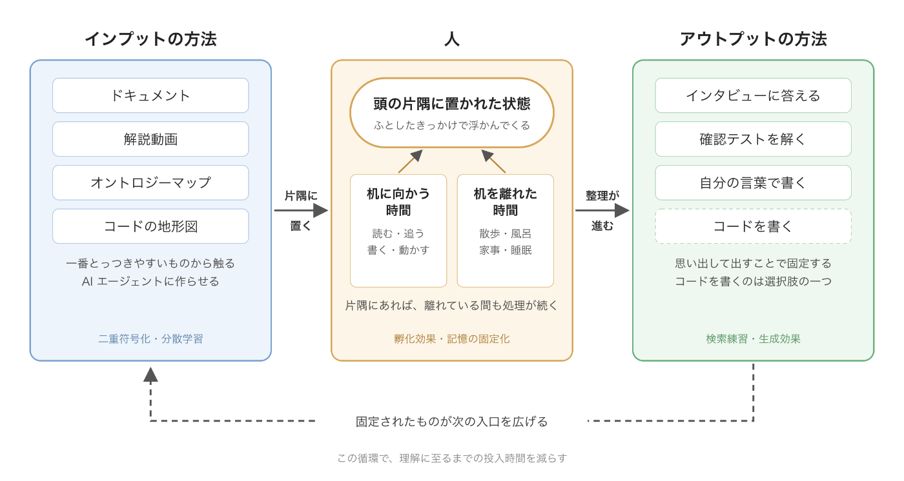

「理解は外注できない」

ただ、AI に理解を手伝ってもらうことはできる。

インプットにもアウトプットにも、方法はたくさんある。どの方法も AI に用意してもらえば、自分専用の知の高速道路を作れる。

インプットは、好きな形で頭に入れて、早く「わかった気」になればいい。

アウトプットは、AI からの口頭インタビューに答えるのがおすすめだ。声に出した内容は、黙読しただけの内容より記憶に残りやすい(プロダクション効果)。さっさとアウトプットして、AI に絶望の谷へ叩き落としてもらおう。

この記事の背景にある「人の理解はどう組み上がるか」は、解説動画(12 分)にまとめています。記事と同じ内容ではなく、認知科学側の土台です。

<figure class="video-embed">
<iframe src="/videos/understanding.html" title="理解を高速化する(解説動画 12:26)" scrolling="no" loading="lazy"></iframe>
<figcaption><a href="/videos/understanding.html" target="_blank" rel="noopener">動画だけを別タブで開く</a>(台本と出典つき)</figcaption>
</figure>

## 「頭の片隅に置かれた状態」を目標にする

頭の片隅に置かれた状態とは、意識の中心にはないが、何かのきっかけで浮かんでくる程度には記憶に残っている状態だと考えている。家事をしていて、さっき読んだ図の一部をふと思い出し、別の知識とつながる。この状態になっていれば、散歩や風呂や家事の時間も理解の工程に組み込まれる。

難しい問題を抱えたまま散歩に出ると、ふと整理がつくことがある。心理学では孵化効果と呼ばれ、課題から離れている間もその課題に関する処理は続いている。睡眠中にも、その日に入れた情報の固定化が進む。ただしどちらも、対象が片隅に置かれていることが前提になる。

片隅にすら置かれていなければ、机を離れた瞬間に処理は止まる。だから目標を「理解する」ことから、まず「さっさと片隅に置かれた状態にする」ことに置き換えた。片隅に置いてしまえば、あとは脳のバックグラウンド処理に任せられる。

## インプットはチャネルを増やしてとにかく触る

片隅に置くための手段が、インプットのチャネルを増やすことだった。同じ対象を、ドキュメント、解説動画、概念同士の関係を描いたオントロジーマップ、コードの地形図、と複数の形で用意する。そして一番とっつきやすいものから入る。

複数の形で触れると、二つの効果がある。一つは二重符号化で、言葉で入れた情報と絵や音で入れた情報は別々に記憶されるので、思い出す手がかりが増える。もう一つは分散学習で、同じ量の情報でも、一度に詰め込むより何回かに分けて触れた方が長く残る。チャネルが複数あれば、触れる回数が自然に増え、間隔も空く。

以前なら、動画や地形図を自分用に作るのは手間に見合わなかった。いまは AI エージェントに作らせている。対象を指定すれば動画もオントロジーマップも地形図も出てくるので、チャネルを増やすコストはほぼなくなった。頭の使い方の話に見えて、半分は道具の話でもある。

## アウトプットは答える、解く、書く

片隅に置かれて整理が進んだものは、アウトプットで固定する。やっているのは、AI エージェントからのインタビューに答える、確認テストを解く、自分の言葉で書く、の三つ。思い出そうとする行為そのものが記憶を強める(検索練習)。自分で説明や文章を生成すると、読んだだけのときより定着する(生成効果)。アウトプットは固定の工程であり、同時に理解を組み立てる工程でもある。

コードを書くことも、ここでは選択肢の一つになった。以前は「書いて動かすまで理解できない」ので、コードを書くことが唯一の経路だった。いまは答える・解く・書くのどれでもよい。

## まとめ

| 工程 | やること | 効いている仕組み |
| --- | --- | --- |
| インプット | チャネルを増やして触り、片隅に置く | 二重符号化、分散学習 |
| 離れる | 散歩・風呂・家事・睡眠 | 孵化効果、睡眠中の固定化 |
| アウトプット | 答える、解く、書く | 検索練習、生成効果、プロダクション効果 |

チャネルを増やしてとにかく触り、片隅に置く。片隅に置かれたものは、机を離れている間に脳が消化する。整理されたものをアウトプットで固定し、固定されたものがまた次の入口を広げる。この循環を回し続けたことで、理解に至るまでの投入時間が減った。やることは一つで、できるだけ早く「頭の片隅に置かれた状態」に持っていくこと。理解はそのあとで進む。

## 動画の出典

- Bransford, J. D., & Johnson, M. K. (1972). Contextual prerequisites for understanding. J. Verbal Learning and Verbal Behavior, 11(6), 717-726. https://doi.org/10.1016/S0022-5371(72)80006-9
- https://memlab.yale.edu/sites/default/files/files/1972_Bransford_Johnson_JVLVB.pdf
- Bartlett, F. C. (1932). Remembering. Cambridge University Press, pp.65-67. https://archive.org/details/Bartlett1932Remembering
- Chase, W. G., & Simon, H. A. (1973). Perception in chess. Cognitive Psychology, 4(1), 55-81. https://doi.org/10.1016/0010-0285(73)90004-2
- Cowan, N. (2001). The magical number 4 in short-term memory. Behavioral and Brain Sciences, 24(1), 87-114. https://doi.org/10.1017/S0140525X01003922
- Bransford, J. D., Barclay, J. R., & Franks, J. J. (1972). Sentence memory: A constructive versus interpretive approach. Cognitive Psychology, 3(2), 193-209. https://doi.org/10.1016/0010-0285(72)90003-5
- Zwaan, R. A., & Radvansky, G. A. (1998). Situation models in language comprehension and memory. Psychological Bulletin, 123(2), 162-185(カメと丸太の実験の確認に使用). https://sites.ualberta.ca/~dmiall/Cognitive/Readings/Zwaan_Radvansky_1998.pdf
- Kintsch, W. (1988). The role of knowledge in discourse comprehension: A construction-integration model. Psychological Review, 95(2), 163-182. https://doi.org/10.1037/0033-295X.95.2.163
- Chi, M. T. H., Feltovich, P. J., & Glaser, R. (1981). Categorization and representation of physics problems by experts and novices. Cognitive Science, 5(2), 121-152. https://doi.org/10.1207/s15516709cog0502_2
- Gick, M. L., & Holyoak, K. J. (1980). Analogical problem solving. Cognitive Psychology, 12(3), 306-355. https://doi.org/10.1016/0010-0285(80)90013-4
- Chi, M. T. H., Bassok, M., Lewis, M. W., Reimann, P., & Glaser, R. (1989). Self-explanations. Cognitive Science, 13(2), 145-182. https://doi.org/10.1207/s15516709cog1302_1
- Chi, M. T. H., de Leeuw, N., Chiu, M.-H., & LaVancher, C. (1994). Eliciting self-explanations improves understanding. Cognitive Science, 18(3), 439-477. https://doi.org/10.1207/s15516709cog1803_3
- Roediger, H. L., & Karpicke, J. D. (2006). Test-enhanced learning. Psychological Science, 17(3), 249-255. https://doi.org/10.1111/j.1467-9280.2006.01693.x
- Rozenblit, L., & Keil, F. (2002). The misunderstood limits of folk science: an illusion of explanatory depth. Cognitive Science, 26(5), 521-562. https://doi.org/10.1207/s15516709cog2605_1

音声は VOICEVOX:ずんだもん / VOICEVOX:四国めたん、イラストは VOICEVOX 公式(© SSS LLC)です。
