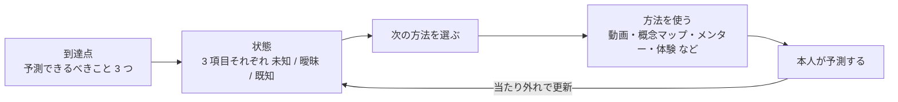

何かを理解しようとするとき、方法はたくさんあります。ドキュメントを読む、解説動画を見る、概念の関係を図にする、人に聞く、確認テストを解く、自分で説明してみる。AI を使えば、どの方法もすぐ用意できます。

方法が揃うと、今度はどれを使うかで迷います。読むだけで済む対象に動画まで作る必要はありません。逆に、何度読んでも分からない箇所に同じ種類の説明を足し続けても進みません。どの方法を使うかは、どこまで理解したいかと、今どこまで分かっているかで決まります。

そこで、この使い分けを担う個人用のフレームワークを作りました。入口は Claude Code の skill 1 つで、方法そのものは既存の skill(解説動画、概念マップなど)を呼び出します。この記事はその組み立てを書きます。

## 全体像

フレームワークは、到達点と状態の 2 つを記録し、そこから次の方法を選びます。



図が示しているのは、方法を使うたびに本人が予測を 1 つ出し、その当たり外れで状態を書き換え、書き換えた状態から次の方法を決める、という循環です。

到達点は最初に 1 回決めます。状態は対象ごとに 1 ファイルあり、次に何をするかは毎回このファイルから決めます。計画を毎回立て直すことはしません。

### 用意している道具

図の「方法を使う」で呼び出す道具は、今は次のとおりです。入口の `/understanding` 以外は、それぞれ単体でも使える Claude Code の skill です。名前の `input-` は頭に入れる側、`output-` は頭から出す側の道具を表します。

1. `/understanding`(入口)
   - 型と到達点を決め、事前テストをし、状態ファイルを読み書きする
   - 自分では対象を解説しない。状態を見て、次に呼ぶ道具を選ぶだけ
2. `input-advance-organizer`(知っているシステムとの対応表)
   - 初めての対象を、知っているシステムとの対応で先に位置づける
   - 例: 「Rails で言うコントローラーが、ここではハンドラー」
   - 対応が成り立たない箇所も一緒に出す
3. `input-ontology-map`(概念マップ)
   - 対象の概念と、概念どうしの関係をソースから抜き出して、1 枚の図にする
   - 評価は [オントロジーマップの記事](/blog/ontology-map-evaluation/) に書いた
4. `input-explainer-video`(解説動画)
   - AI が調べて台本を書き、質問役と解説役の 2 人が掛け合う音声付きの動画にする
5. `input-terrain-map`(コードベースの地図)
   - 実際に読んだ場所を訪問記録として貯め、リポジトリごとに育つ地図にする
   - よく訪れた場所ほど濃く表示されるので、どこに詳しいかが見える
6. `mentor`(メンター)
   - 答えを渡す前に逆質問を 1 つ返す対話
   - 本人がすでに知っていることから辿り着けそうなら考えさせ、欠けている部品だけを教える
7. `output-unknown-knowledge`(知らないことの洗い出し)
   - 対話で質問して理解度を推定し、知らないと気づいていなかった項目を出す
   - 到達点を書く段階で、その領域に何があるか自分でも分からないときの材料集めに使う
8. `output-knowledge-interview`(説明させるインタビュー)
   - 概念ごとに、想起 → 仕組みの説明 → 転移の 3 段で本人に答えさせ、本人の言葉のままノートに残す
   - 外ループをこの skill で回すこともできる(後の節で書く)
9. 声のインタビュー(skill ではなく別のスクリプト)
   - 問いを順に読み上げ、声の答えをそのまま記録する
   - 事前テストと中ループの説明を、文字を打たずに回すときに使う

## 到達点を先に決める

この節では、「理解した」の中身を最初に決める理由を書きます。

Before: 「決済サービスを理解する」。読めるものから順に読みます。どこまで読めば終わりかが決まっていないので、終わりません。

After: まず、理解したあとに何ができるようになりたいかを選びます。ここでは「障害対応ができる」を選んだとします。すると、予測できるべきことが 3 つに絞れます。

1. 返金リクエストが来てから残高が戻るまで、どのサービスをどの順で通るか
2. 途中で失敗したとき、どこで止まり、何が再送されるか
3. 二重返金を防いでいる仕組みはどこにあるか

読むものはこの 3 つに答えるためだけに選びます。3 つに答えられれば、この目的では理解できたことにします。

「何ができるようになりたいか」は、今は 3 つの型に分けています。

- 話についていける
  - 会議や PR の議論で、用語と関係が分かる
  - 予測できるべきことは「概念の名前と関係を言える」
- 調査・障害対応ができる
  - 現象から原因の場所を予測できる
  - 予測できるべきことは「流れ」「失敗時の挙動」「失敗を防ぐ仕組み」
- 変更を入れられる
  - 設計判断の理由を説明し、別の場面に当てはめられる
  - 上に加えて「なぜこの構造か」「こう変えたらどうなるか」

型を先に決めるのは、型によって使う方法と回し方が変わるからです。話についていければよい対象に、時間を空けた確認を何度も入れる必要はありません。同じ決済サービスでも、目的が変われば予測できるべきことが変わり、別の周回になります。

本人が型を決めかねているときは、「その対象で近く予定している作業は何か」を 1 つだけ聞き、その答えから型を当てはめます。

## 状態を予測で測る

この節では、状態をどう測るかを書きます。状態が正しくないと、次の方法の選び方も外れます。

状態は 3 項目それぞれについて 3 段階です。

- 未知: まだ触っていない、または問われて答えられなかった
- 曖昧: 説明はしたが予測が外れた、または 2 回目の説明ができなかった
- 既知: 予測が当たった、または仕組みを正しく説明できた

既知に上げるのは、本人の予測か説明を判定したときだけです。本人が「分かった」と言っても上げません。読んでいる間の「分かった」は、読みやすかったという信号で、理解の信号ではないからです。この仕組みは [流暢性バイアスの記事](/blog/fluency-vs-diff/) に書きました。

測り始めるのは、何かを読む前です。3 項目をそのまま本人に問い、答えを状態ファイルに書きます。答えられなくて構いません。答えられた項目には、そもそも入力を振りません。

読む前に測るのは、読んだ後に測ると、読んだ直後の読みやすさが判定に混ざるからです。読む前の答えがあれば、読んだ後の答えと比べて何が変わったかが分かります。

状態ファイルには、本人の答えをそのまま書きます。AI の解説は書きません。次に何をするかを決める材料は本人が何を言えたかで、AI が何を説明したかではないからです。

## 状態から方法を選ぶ

この節では、状態と型から次の方法を選ぶ規則を書きます。フレームワークの中心はこの規則です。

確認テストも、解説動画も、メンターとの対話も、ここでは方法の 1 つです。どれが正解ということはなく、状態によって向き不向きが変わります。

- 未知で、対象自体が初めて
  - 知っているシステムとの対応表で、全体の位置づけを先に入れる
- 未知
  - 流れを問う項目なら解説動画
  - 「どこにあるか」を問う項目ならコードベースの地図
  - 概念の関係を問う項目なら概念マップ
- 曖昧
  - 予測が外れた箇所の部品だけを、動画か概念マップで入れて、もう 1 度予測する
  - 2 回外れたら、メンターで欠けている部品だけを埋める
- 曖昧で、同じ答えが 3 回続いた
  - 説明を足すのをやめて、体験に切り替える(下で書きます)
- 既知
  - 触らない

曖昧のときに入れるのは、外れた箇所の部品だけです。項目全体を説明し直すと、すでに当たっている部分まで読むことになり、読みやすさだけが上がります。

### 説明で答えが変わらないときは体験に切り替える

動画、対応表、メンターと説明の種類を変えても、本人から毎回同じ答えが返ってくることがあります。このとき本人の頭の中では、今の理解の仕方で問いに答えられてしまっています。そのため、新しい説明を読んでも、今の理解の仕方に合う部分だけが拾われ、答えが変わりません。

この状態を見たら、説明をそれ以上足さず、方法の種類を変えます。

```text
説明を 3 回入れても同じ答え
   │
   ▼
1. 本人が必ず詰まる初見の問題を出す
2. 詰まったら「動かす候補に入れていない部品はどれ?」とだけ聞く
3. 解けたら「切り替わった瞬間」と「その直前の試行」を分けて言わせる
   │
   ▼
その切り分けを材料に、元の項目をもう一度説明させる
```

図が示しているのは、本人が詰まった経験そのものを材料にして、元の項目に戻るという流れです。

たとえば「気づきはどういう条件で起きるか」という項目で同じ答えが続いたとします。そこでマッチ棒算術を出します。

```text
III = III + III      (3 = 3 + 3。成り立たない)
```

マッチ棒を 1 本だけ動かして、正しい式にします。数字を動かす案から試すと詰まります。正解は + の縦棒を寝かせて = にすることで、`III = III = III` になります。= や + は「動かさないもの」として最初から候補から外れているので、詰まるまで出てきません。Knoblich たちが 1999 年に、この種の問題で人が暗黙に置いている制約を調べています。

詰まった後で「動かす候補に入れていない部品はどれ?」と聞くと、記号が候補に入り、解けることがあります。解けた後に「切り替わったのはいつで、その直前は何を試していたか」を本人に分けて言わせます。すると「ヒントで解けたのは、数字をいじる案が尽きて詰まった後だった」という自分の経験が手元に残ります。この経験を材料に元の項目に戻ると、説明を何度読んでも出なかった答えが、本人の言葉で出ます。

コードベースが対象のときは、本人の予測が外れる挙動を実際に動かして見せる、という形を考えています。こちらはまだ試していません。

## 時間で 3 本のループを回す

この節では、同じ項目に時間を空けて何度か戻る仕組みを書きます。

直後に言えたことが、時間を空けると言えなくなることがあります。そのため、1 回当たっただけでは既知を確定させず、時間を空けて同じ項目をもう一度判定します。間隔の長さで 3 本のループに分けています。

- 内側(分)
  - 方法を 1 つ使ったら、その場で予測を 1 つ出す
  - 外れたら、外れた箇所に出た部品を 1 回だけ入れて、もう 1 度予測する
  - 理解しきろうとせず、次の項目へ移る
- 中(分〜時間)
  - 別の項目か別の作業を挟んだ後、最後に触った項目を何も見ずに説明する
  - 説明できなければ、既知から曖昧に戻す
- 外(時間〜日)
  - 3 項目すべてを、想起 → 仕組みの説明 → 転移の 3 段で問う
  - 転移は「もしこう変わったらどうなるか」を、本人の仕事の別の場面で問う
  - 転移の予測が当たれば既知、外れれば曖昧
  - その場で回すか、`output-knowledge-interview` で回すかを選べる

`output-knowledge-interview` で回すときは、問うのはインタビュー側、判定と状態の更新は `/understanding` 側に分けています。

```text
/understanding 較正           本人                              output-knowledge-interview
 実行するコマンドを出す ──→ インタビューを起動する ──→ 3 項目を 3 段で問い、
 (3 項目だけを渡す)                                         本人の答えをノートに残す
 ノートを読んで判定し、    ←── もう一度 /understanding 較正 ←──┘
 状態ファイルに写す
```

インタビューに渡すのは 3 項目と、すでに使った転移の場面だけです。状態ファイルにある本人の過去の答えや外れた箇所は渡しません。渡すと、問う側がそれをヒントにしてしまうからです。

外ループの間隔は、初回をその回の終わりに置き、2 回目を数時間後にし、以後は前回の 2 倍にします(数時間 → 半日 → 1 日 → 2 日)。曖昧が増えたら半分に戻します。間隔を固定すると、既知は「その間隔を空けても言えた」ことしか示しません。倍にしていけば、どこまで空けても言えるかが分かります。

転移を本人の別の場面で問うのは、例題と同じ場面で問うと、問題の見た目を手がかりに答えを思い出せてしまうからです。見た目の違う場面で答えられれば、仕組みとして持っていることが分かります。

最初は「次は翌日」のように日を単位にしていましたが、やめました。短い時間でどこまで理解できるかを測りたかったからです。忘れ方の種類は [忘却の記事](/blog/forgetting-is-six-events/) に書いています。

## 付き合い続けられるチャンネルを用意する

この節では、本人が続ける気になれるようにした工夫を書きます。理解の工程として正しくても、本人が途中でやめれば状態は更新されません。

このフレームワークは、本人にかなりの手間をかけさせます。読む前に答える、時間を空けて戻る、何も見ずに説明する。どれも、ただ読むより面倒です。そこで、同じ工程をいくつかのチャンネルで回せるようにしています。

- 声で答える
  - 事前テストと中ループの説明は、文字を打たずに声で答えられる
  - 問いを読み上げ、答えをそのまま記録する別のツールを使う
  - 問いの文面は記録側の AI に渡さないので、ヒントや訂正が混ざらない
- キャラクターが掛け合う解説動画
  - 質問役と解説役の 2 人が掛け合う音声付きの動画
  - 読み飛ばせないので、文章より最後まで見やすい
- 説明させるインタビュー
  - 自分で問いを考えなくても、AI が順に問いを出してくれる
  - 本人は思い出して答えるだけでよく、答えはそのままノートに残る
- 逆質問から入るメンター
  - 答えをすぐ渡さず、本人が知っていることから辿らせる
  - 前提がずれていれば、答える前に指摘する
- コードベースの地図、概念マップ、知っているシステムとの対応表
  - 文字で読む代わりに、図で全体を見られる

チャンネルを増やす目的は、理解の効率だけではありません。その日の自分が付き合える形を選べるようにするためです。疲れている日は声で答え、時間がある日は図を見ながら考える。どのチャンネルを使っても、判定は同じ予測の当たり外れで行い、同じ状態ファイルに書きます。

## 出典

- Knoblich, Ohlsson, Haider & Rhenius (1999) Constraint relaxation and chunk decomposition in insight problem solving. Journal of Experimental Psychology: Learning, Memory, and Cognition 25(6).
